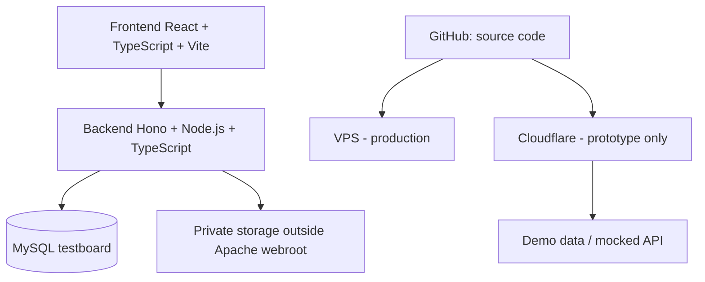
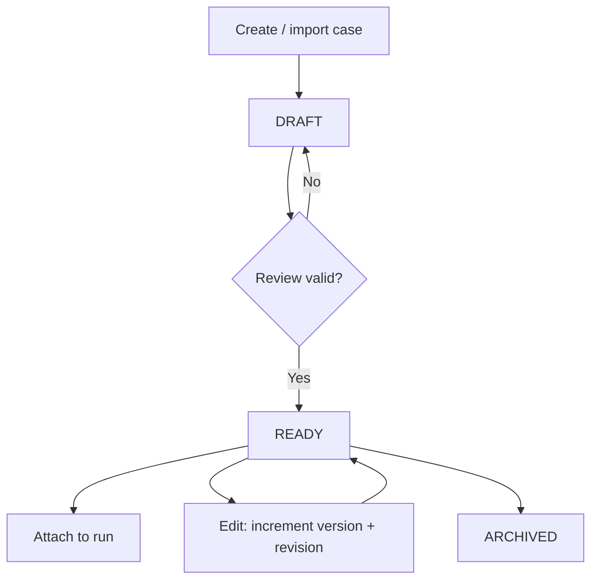
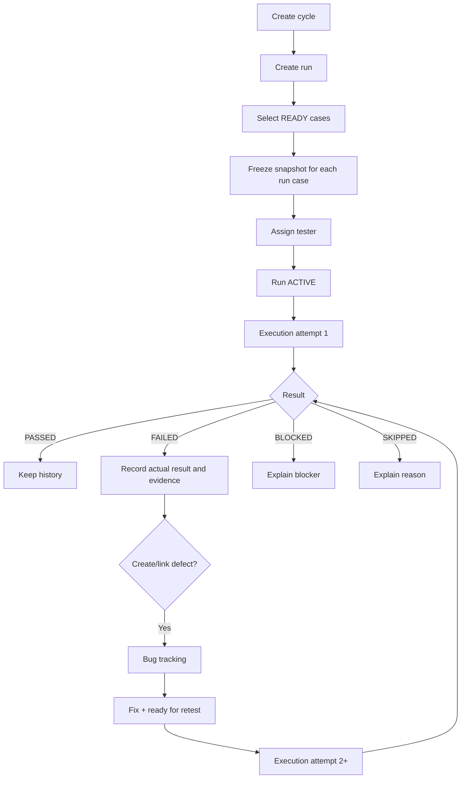
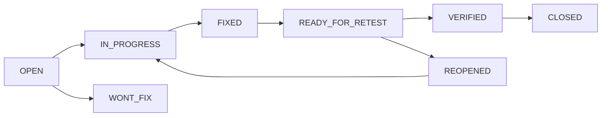
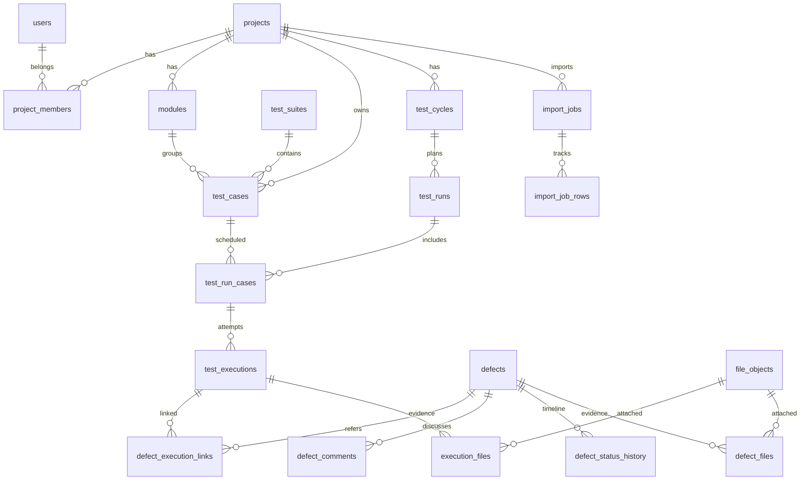
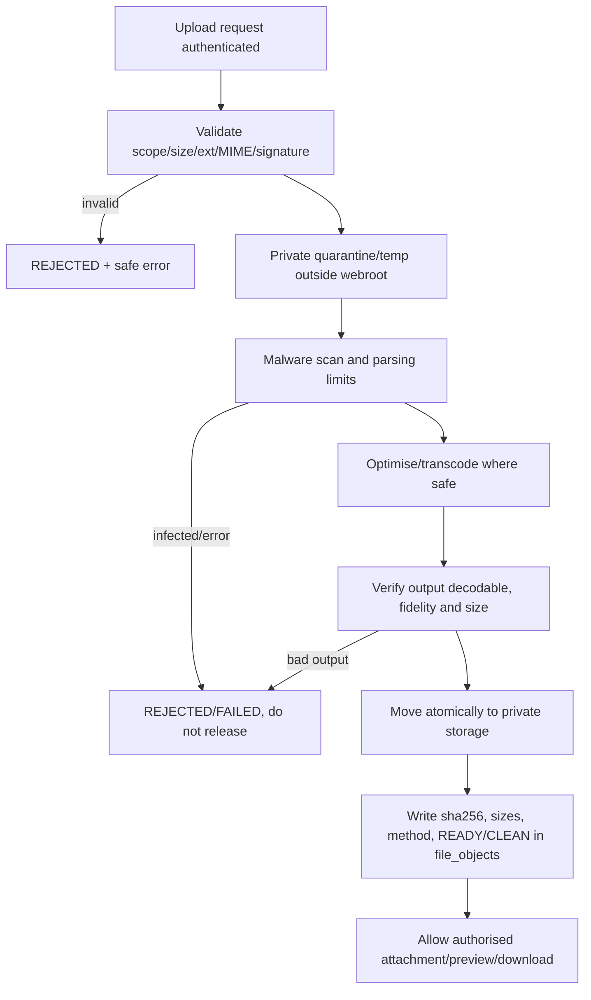

# MASTER SPECIFICATION - TESTBOARD PASKER ID

> Generated from README and docs 01-18. For modular consumption, see separate files.


---

<!-- SOURCE: README.md -->

# TestBoard PASKER ID - Blueprint Pengembangan v1.0

**Tanggal penyusunan:** 19 November 2026  
**Status:** Spesifikasi & referensi pengembangan; **BUKAN** source code aplikasi siap pakai  
**Bahasa dokumen:** Indonesia | **UI:** Indonesia + English  
**Database produksi eksisting:** MySQL `testboard` (27 base tables + 1 view sudah dibuat)  
**Konteks deploy:** GitHub repo independen; prototype Cloudflare (data dummy); production VPS Contabo + MySQL VPS.  

## Mulai di sini

1. Baca `docs/01_PRODUCT_VISION_PRD.md` untuk tujuan, scope, dan MVP.
2. Baca `docs/02_FUNCTIONAL_SPECIFICATION.md` untuk aturan proses.
3. Baca `docs/03_UI_UX_DESIGN_SYSTEM.md` dan `docs/04_SITEMAP_AND_SCREEN_SPECS.md` untuk implementasi layar.
4. Baca `docs/05_DATABASE_AND_DATA_DICTIONARY.md` dan `database/schema_baseline_reference.sql`. **Jangan jalankan SQL baseline lagi di VPS yang telah berisi skema.**
5. Baca `docs/06_API_CONTRACT.md`, `docs/07_EVIDENCE_UPLOAD_PROCESSING.md`, `docs/08_IMPORT_LEGACY_AND_AI.md`.
6. Ikuti `docs/11_LOCAL_DEVELOPMENT.md`, lalu `prompts/AI_BUILD_PROMPTS.md` bila menggunakan AI coding agent.
7. Pastikan semua acceptance criteria di `docs/13_UAT_ACCEPTANCE_CRITERIA.md` terpenuhi sebelum dipakai tim.

## Daftar dokumen

| Lokasi | Isi |
|---|---|
| `docs/01_PRODUCT_VISION_PRD.md` | Product requirements, scope, roadmap, KPI |
| `docs/02_FUNCTIONAL_SPECIFICATION.md` | FSD terperinci, aturan status, alur operasional |
| `docs/03_UI_UX_DESIGN_SYSTEM.md` | UI theme, komponen, responsif, aksesibilitas |
| `docs/04_SITEMAP_AND_SCREEN_SPECS.md` | Navigasi, layout, spesifikasi layar/form |
| `docs/05_DATABASE_AND_DATA_DICTIONARY.md` | Struktur database existing, FK, batasan skema |
| `docs/06_API_CONTRACT.md` | API endpoints, payload, error response |
| `docs/07_EVIDENCE_UPLOAD_PROCESSING.md` | Multi-upload, keamanan, kompresi, file lifecycle |
| `docs/08_IMPORT_LEGACY_AND_AI.md` | Import Excel/CSV/JSON, mapping, gambar tertanam |
| `docs/09_AUTH_RBAC_SECURITY.md` | Login, role, keamanan data, audit, backup |
| `docs/10_INTERNATIONALIZATION.md` | EN/ID, kode status, kamus label |
| `docs/11_LOCAL_DEVELOPMENT.md` | Setup lokal Windows/Linux, DB development |
| `docs/12_VPS_CLOUDFLARE_DEPLOYMENT.md` | VPS LAMPP, update.sh, prototype Cloudflare |
| `docs/13_UAT_ACCEPTANCE_CRITERIA.md` | Uji penerimaan TestBoard itu sendiri |
| `docs/14_ROADMAP_BACKLOG.md` | Tahapan coding, dependensi, urutan sprint |
| `docs/15_OPEN_DECISIONS_AND_GAPS.md` | Hal yang belum diputuskan / perlu migrasi skema |
| `docs/16_RESEARCH_REFERENCES.md` | Workbook pengguna & sumber teknis resmi |
| `docs/17_SOURCE_MAPPING.md` | Mapping hasil pemeriksaan 3 workbook pengguna |
| `docs/18_TEXT_WIREFRAMES.md` | Text wireframes untuk dashboard, execution, bug, import |
| `database/schema_baseline_reference.sql` | Snapshot **referensi** SQL yang sudah dijalankan; jangan rerun pada produksi |
| `database/DATABASE_READ_ONLY_CHECKS.sql` | SQL read-only untuk memverifikasi tabel dan view |
| `database/DATA_DICTIONARY_GENERATED.md` | Tabel, kolom, tipe, constraints hasil parsing SQL |
| `examples/ai_testcases_sample.json` | JSON **dummy**, tidak mengandung data pribadi |
| `examples/testcase_import_template.csv` | Header CSV standar |
| `examples/ai_testcases.schema.json` | JSON Schema input AI |
| `examples/Template_Import_Test_Case_UAT.xlsx` | Template XLSX yang sudah dibuat sebelumnya |
| `config/*.env.example` | Template environment lokal tanpa rahasia |
| `config/docker-compose.dev.yml` | Opsional: MySQL lokal untuk pengembangan |
| `ops/update.sh.example` | Contoh alur deployment, **tidak otomatis aman untuk produksi** |
| `AGENTS.md` dan `prompts/AI_BUILD_PROMPTS.md` | Instruksi untuk AI coding agent |

## Arsitektur yang disepakati



- **Produksi**: frontend di Apache, API Node.js di VPS (loopback), MySQL satu VPS; file lampiran disimpan di private storage VPS, **bukan sebagai BLOB** di MySQL.
- **Prototype presentasi**: Cloudflare hanya frontend/opsional mock API memakai data dummy; jangan menaruh kredensial MySQL produksi di Cloudflare atau React.
- **Lokasi repo yang diinginkan pengguna**: `/opt/lampp/htdocs/paskerid/public/testboard/`. Ini dapat digunakan sebagai checkout Git independen, **tetapi sebelum diakses publik Apache harus dibatasi sehingga hanya output frontend `dist` yang dapat disajikan**. Lihat `docs/12_VPS_CLOUDFLARE_DEPLOYMENT.md`.
- **Development lokal**: gunakan database testboard **lokal** terpisah dari database VPS produksi; gunakan `127.0.0.1:3307` jika menjalankan Docker Compose contoh.

## Sumber dan keterbatasan

- Spesifikasi dibangun dari tiga workbook UAT pengguna dan snapshot skema MySQL yang telah diberikan dalam percakapan; rincian ada di `docs/17_SOURCE_MAPPING.md`.
- File Excel asli **tidak disertakan** ke ZIP untuk menghindari distribusi tak sengaja data staf/bukti UAT. Template dan contoh dummy tetap disertakan.
- Sampel data dalam ZIP adalah **dummy**; bukan data yang diambil dari UAT asli.
- SQL baseline **bukan migrasi baru** dan tidak membuat user MySQL; akun `testboard_app` sudah dibuat oleh pengguna di VPS.
- Tidak ada koneksi ke GitHub, Cloudflare, atau database VPS yang dilakukan untuk membuat paket ini.

## Definition of Done sebelum mulai tim memakai aplikasi

- Login + RBAC di sisi backend (bukan sekadar menyembunyikan tombol).
- Impor test case dengan preview, mapping, deduplikasi dan audit.
- Eksekusi, retest, pengaitan bug tanpa menimpa riwayat lama.
- Upload multi-file: scan + optimasi ketika layak + storage privat + metadata DB.
- Dashboard berbasis latest execution per run; ekspor laporan aman.
- Indonesia/English konsisten; mobile responsive; tidak ada kredensial dalam bundle frontend.
- Backup, logging, monitoring, HTTPS dan pengujian keamanan dasar.

**Catatan:** Ini blueprint siap dipakai sebagai acuan coding, bukan software final.


---

<!-- SOURCE: docs/01_PRODUCT_VISION_PRD.md -->

# 01 - Product Requirements Document (PRD)

## Identitas produk

- Nama: **TestBoard PASKER ID**; nama UI ringkas: **TestBoard**.
- Deskripsi: platform berbasis web untuk mendokumentasikan test case, merencanakan siklus UAT, melakukan pengujian, menyimpan bukti, melacak defect, dan menyusun laporan.
- Inspirasi pola navigasi: issue/project workspace sekelas Jira; **bukan replika Jira** atau integrasi Jira.
- Target: tim QA/UAT, Business Analyst, pengembang, pengelola produk, pimpinan/pemantau, dan admin aplikasi.
- Bersifat **multi-project** sehingga tidak mengunci TestBoard hanya pada Karirhub.

## Masalah dari alur saat ini (berdasarkan workbook)

1. Master test case, pelaksanaan UAT, dan tracker tindak lanjut tersebar di beberapa workbook/sheet.
2. Form UAT memiliki identitas case, prasyarat, langkah, expected result, status, bukti, penguji, tanggal, catatan.
3. Tracker terpisah memiliki severity, hasil aktual/defect, retest status, catatan retest, serta gambar tertanam.
4. Pengulangan ID UAT dalam tracker dapat merepresentasikan tambahan catatan/bukti. Import langsung satu baris ke satu test case akan menghasilkan duplikat.
5. Bahasa UI perlu ID/EN dan hasil UAT harus dapat dicari serta diekspor.

## Sasaran produk

- Single source of truth untuk test case dan seluruh jejak eksekusi UAT.
- Workflows dari draft -> siap uji -> run -> execution -> defect -> fix -> retest -> verified/closed.
- Memungkinkan satu kasus mempunyai beberapa attachment untuk tiap eksekusi, bukan satu screenshot per kasus.
- Impor **hasil AI atau Excel lama** dengan validasi dan preview sebelum commit.
- Mendukung lintas proyek, modul, role, build/version, serta release/siklus pengujian.
- Bukti uji tersedia hanya bagi personel berwenang; otomatis melalui pipeline pemrosesan file.

## Non-goals MVP

- AI yang otomatis mengeksekusi website target; versi awal hanya **import AI-generated test cases** (file yang dibuat di luar TestBoard).
- Sinkronisasi dua arah dengan Jira/GitHub Issues.
- Public issue tracker terbuka untuk siapa saja.
- Menyimpan binary screenshot/video dalam MySQL.
- Terjemahan otomatis konten UAT memakai AI tanpa persetujuan pengguna.
- Cloudflare demo dengan koneksi ke database produksi.

## Ruang lingkup minimum (P0)

| ID | Kapabilitas | Output wajib |
|---|---|---|
| PRD-01 | Login, logout, sesi | Autentikasi aman, akun aktif |
| PRD-02 | Project & member | Multi-project, role project |
| PRD-03 | Modul/suite/case | CRUD, pencarian, filter, revisi |
| PRD-04 | Cycle/run | Daftar case untuk run; freeze snapshot |
| PRD-05 | Execution/retest | Hasil per attempt, tak menimpa riwayat |
| PRD-06 | Bug tracker | Defect standalone dan link ke execution |
| PRD-07 | Evidence | Multi-upload, private file, kompresi & scan |
| PRD-08 | Import AI/legacy | XLSX/CSV/JSON, mapping, preview, dedup |
| PRD-09 | Reporting | Dashboard, export daftar, KPI |
| PRD-10 | Bilingual | ID/EN UI, locale user, fallback |
| PRD-11 | Audit | Jejak CRUD dan status transition |
| PRD-12 | Responsive | Desktop/tablet/mobile usable |

## P1 (setelah MVP)

- Bulk assign dan bulk editing aman.
- Templated reports PDF; notifikasi in-app/email dengan queue.
- Saved filter/advanced search; timeline diskusi yang lebih kaya.
- Import gambar tertanam di Excel secara otomatis dengan anchor detection jika tidak sempat di P0 (tetap target tinggi).
- Role & invite lebih granular, tagging, dashboard per milestone, accessibility audit.

## P2 (opsional)

- Webhooks, integrasi GitHub Issue, AI-assisted case generation langsung di dalam aplikasi, analytics tren regresi, API token, integrasi SSO.

## KPI produk

- % test case yang masuk ke run dan terselesaikan; % case Passed/Failed/Blocked/Not Run.
- Jumlah defect aktif menurut severity, waktu dari dilaporkan sampai verified, reopened rate.
- Rasio keberhasilan import tanpa koreksi; jumlah duplikat yang ditangani.
- Waktu rata-rata unggah evidence sampai `READY`, rasio kompresi rata-rata menurut jenis.
- Tingkat kelengkapan evidence untuk FAILED execution.

## Prinsip analitik

- Denominator pass rate: jumlah run case yang valid, bukan jumlah seluruh attempt.
- **Latest status** diambil dari view `v_run_case_latest_status`, sedangkan riwayat attempt tetap dapat dilihat.
- `NOT_RUN`, `BLOCKED` dan `SKIPPED` **bukan** Passed.
- Severity milik defect, bukan status pengujian.
- Angka dashboard dapat difilter menurut project, module, cycle, run, tester, build, dan date range.

## Batas keputusan (yang masih perlu disepakati)

Lihat `docs/15_OPEN_DECISIONS_AND_GAPS.md`. Jika belum diputus, AI builder memakai konfigurasi konservatif dan menandai asumsi, bukan menambahkan field database secara sembarang.


---

<!-- SOURCE: docs/02_FUNCTIONAL_SPECIFICATION.md -->

# 02 - Functional Specification Document (FSD)

## 1. Entitas dan relasi proses

1. **Project** memiliki anggota, modul, test suite, test cycle, test run, test case dan defect.
2. **Test Case** adalah definisi reusable (kode, kategori, langkah, expected result), bukan hasil uji.
3. **Test Run** adalah kumpulan test case pada lingkungan dan versi/build tertentu.
4. **Run Case** (`test_run_cases`) adalah satu case terjadwal pada sebuah run, dengan assigned tester dan snapshot.
5. **Execution** (`test_executions`) adalah satu attempt pengujian. Attempt `1` awal; `2+` retest/rerun.
6. **Defect** dapat terkait satu atau banyak executions, atau dibuat mandiri (misalnya bug pasca-UAT).
7. **Evidence** dapat terkait case (dokumen acuan), execution (bukti hasil), atau defect (reproduksi/patch).

## 2. Flow test case



### Ketentuan

- Unique `(project_id, case_code)`, bukan unique global.
- `case_code` dapat dimasukkan manual atau dihasilkan backend dengan atomisitas dan validasi duplikat.
- Field wajib: project, case code, title, expected result; module/suite dianjurkan wajib di UI impor.
- `case_status`: `DRAFT | READY | ARCHIVED`; archival tidak menghapus riwayat.
- Edit setelah pernah dipakai run: tambah `current_version`, simpan snapshot revision; run lama tetap memakai `case_snapshot_json` dan `case_version` lama.
- `test_case_steps` opsional jika pemisahan langkah detail; `test_steps_text` harus tetap menyimpan langkah asli legacy.

## 3. Flow test run & execution



- Run: `PLANNED -> ACTIVE -> COMPLETED` atau `LOCKED` (bila disetujui); edit run yang telah locked dibatasi.
- Attempt dieksekusi menggunakan **database transaction dan lock run case** atau mekanisme atomic untuk menetapkan `attempt_number`, agar dua tester tidak membuat nomor attempt sama.
- Execution status: `NOT_RUN`, `IN_PROGRESS`, `PASSED`, `FAILED`, `BLOCKED`, `SKIPPED`.
- `FAILED`: `actual_result` wajib dan UI menampilkan opsi membuat/link defect; evidence disarankan wajib atau harus memberi alasan bila tidak ada (aturan belum hard constraint di SQL).
- `BLOCKED`: alasan wajib; jangan dihitung passed/failed.
- `SKIPPED`: alasan wajib; jangan mengubah status case master.
- Retest: buat row baru `test_executions`, `execution_kind=RETEST`, `attempt_number` meningkat.
- `test_execution_steps` mendukung hasil tiap langkah. Jika langkah case berubah, history tetap dibaca dari snapshot run agar tidak berubah makna.
- Satu execution bisa punya banyak file; seluruh file harus `READY` dan `scan_status=CLEAN` sebelum diunduh user lain.

## 4. Flow defect



- Status sesuai SQL: `OPEN|IN_PROGRESS|FIXED|READY_FOR_RETEST|VERIFIED|REOPENED|CLOSED|WONT_FIX`.
- `FAILED` test **tidak otomatis mengubah status defect**. Pengguna memilih create/link defect agar tidak menciptakan bug palsu/duplikat.
- Defect wajib mempunyai `project_id`, `bug_code`, `title`, `severity_code`, `priority_code` dan status.
- Boleh dilaporkan setelah UAT, tanpa `defect_execution_links`.
- `bug_code`: auto generate per project, mis. `BUG-KAR-0001`, transaksional.
- Severity: `CRITICAL|HIGH|MEDIUM|LOW|INFO`; priority: `URGENT|HIGH|MEDIUM|LOW`.
- Developer dapat mark FIXED, tester/QA melakukan verifikasi; jika gagal retest: REOPENED dengan alasan.
- Saat perubahan status, tulis `defect_status_history` dan `audit_logs` dalam transaksi yang sama.
- Diskusi bug disimpan di `defect_comments`, lampiran di `defect_files`.

## 5. Import test cases

1. Pengguna memilih project, target module/suite, mode impor dan file.
2. Backend upload sementara ke area privat; validasi ekstensi, signature, ukuran dan anti-malware.
3. Parser XLSX/CSV/JSON membaca sheet/header (termasuk sheet berbeda format).
4. Form mapping kolom dengan sample preview & penjelasan field wajib.
5. Normalisasi status, tanggal, prioritas, tipe uji; tangani formula dan empty rows; cari ID duplikat.
6. Preview menampilkan angka valid/error/duplicate; pengguna memilih skip/update/new revision.
7. Konfirmasi commit secara bertahap/transaction batch; masukkan `import_jobs` dan `import_job_rows` dengan error per baris.
8. Jika mode legacy hasil UAT diaktifkan, buat run & execution secara **eksplisit**; tidak otomatis menganggap `Status Retest=Closed` sebagai passed.
9. File Excel berisi embedded image: relasi gambar dengan cell anchor melalui `import_job_row_files`, `file_objects`, kemudian link ke execution/bug sesuai hasil review.

## 6. File evidence

- Multi-file upload dan drag/drop di case, execution, defect; ada kategori screenshot/video/document/log.
- File source tidak disimpan sebagai binary di MySQL; `file_objects` berisi metadata private key dan processing status.
- Semua file **wajib melewati pemeriksaan/optimasi pipeline**, tetapi file yang sudah terkompresi atau format lossless tertentu mungkin tidak lebih kecil; simpan penjelasan `compression_note` (jangan memaksakan kualitas turun).
- Tidak ada direct public URL; download/preview melalui backend authorization.

## 7. Role & akses

- `ADMIN`: project settings/member, seluruh modul dan laporan pada project.
- `QA_LEAD`: kelola case, suite, run, assign, import; review bug; laporan.
- `TESTER`: menjalankan assigned cases, upload evidence, lapor bug, komentar.
- `DEVELOPER`: baca case/run, kelola defect assigned, update fix/status, komentar; tidak mengubah expected result.
- `VIEWER`: baca data project yang diizinkan (attachment mengikuti izin baca), ekspor sesuai kebijakan.
- Role ada pada `project_members`. **Global Super Admin belum direpresentasikan pada schema**; lihat gap.

## 8. Audit & report

- Audit create/update/delete/STATUS_CHANGE/IMPORT/DOWNLOAD dengan actor, project, entity, request ID dan timestamp; sensitif redaction.
- Dashboard tidak boleh menghitung 3 attempt sebagai 3 test cases.
- Ekspor XLSX/CSV untuk laporan; hindari formula injection di kolom buatan user.
- Semua query scoped pada `project_id` dan role user; route parameter ID bukan bukti hak akses.

## 9. Error handling

- Validasi field sebelum submit, error per field jelas dalam ID/EN.
- API error berbentuk `code`, `message`, `details`, `request_id`.
- Jangan menampilkan stack trace, SQL atau storage key ke browser.
- File processing asynchronous menampilkan status `PROCESSING`; gagal -> `FAILED/REJECTED` dengan alasan yang aman.
- Semua operasi berulang sensitif gunakan idempotency key untuk mencegah double create.

## 10. Contoh aturan yang tidak boleh dilanggar

- Edit test case asli tidak boleh mengubah hasil UAT historis.
- Hasil Passed pada retest tidak menghapus FAILED pada attempt sebelumnya.
- Defect CLOSED tidak otomatis mengubah execution FAILED lama menjadi PASSED.
- Semua data hanya dapat dilihat dari project tempat user menjadi anggota dan diberi izin.
- `Status Retest` pada Excel lama berbeda dengan status execution dan harus diproses sebagai informasi legacy, bukan dinormalisasi diam-diam.


---

<!-- SOURCE: docs/03_UI_UX_DESIGN_SYSTEM.md -->

# 03 - UI/UX & Design System

## Brand dan arah visual

Nama produk: **TestBoard**; supporting brand: **PASKER ID**. Gaya: produk SaaS enterprise modern, clean, kontras tinggi, navigasi padat tapi teratur, nyaman dipakai sepanjang hari. **Warna di bawah adalah usulan desain, bukan klaim warna resmi instansi.**

| Token | Contoh | Kegunaan |
|---|---|---|
| `brand.700` | `#0D5B4B` | Sidebar aktif, CTA primer |
| `brand.600` | `#157563` | Hover/links |
| `brand.100` | `#DFF2EA` | Selected state |
| `ink` | `#17252B` | Teks |
| `bg` | `#F7F9F8` | Canvas app |
| `surface` | `#FFFFFF` | Tabel/card/modal |
| `border` | `#DAE3DF` | Divider |
| `danger` | `#B42318` | Gagal/critical |
| `warning` | `#A46100` | Blocked/perhatian |
| `success` | `#207651` | Passed |
| `info` | `#2162A5` | Informasi |

- Font: Inter atau system UI (fallback tanpa wajib font eksternal).
- Skala spacing 4/8/12/16/24/32 px; radius 8-12 px; shadow ringan.
- Desktop layout: left sidebar 248 px; topbar; konten max 1440 px; page header + action group.
- Tablet: collapsible sidebar; smartphone: drawer + header; tabel punya horizontal scrolling/column visibility dan card detail.
- Light/dark mode opsional P1; bilingual P0.
- Icon: Lucide; jangan gunakan emoji sebagai indikator status utama.

## Struktur navigasi utama

1. Dashboard
2. Projects (project switcher)
3. Test Cases
4. Test Plans / Cycles
5. Test Runs
6. Bug Tracker
7. Evidence Center
8. Imports
9. Reports
10. Team & Settings

## Pattern UI wajib

- Search global + per-page; filter chip status/module/priority/assignee/date.
- List view: column customization, sort, pagination server-side, selection, bulk actions (dengan konfirmasi).
- Detail view: header status, metadata sidebar, tab Overview / Steps / Evidence / History / Linked bugs.
- Create/edit pakai form dengan validasi per field, autosave draft opsional; konfirmasi meninggalkan form unsaved.
- Upload: drag/drop + file picker, multiple, preview, progress, processing status, remove per file.
- Image preview modal dengan zoom dan pan, navigasi previous/next, file caption, informasi sebelum/sesudah ukuran.
- Activity timeline yang menampilkan siapa, kapan, dan apa yang berubah.
- Empty states dengan CTA; skeleton loaders; toast yang ringkas; error dengan kode referensi.
- Destructive action memerlukan konfirmasi dan memeriksa FK/soft delete.

## Komponen standar

`AppShell`, `ProjectSwitcher`, `PageHeader`, `Breadcrumbs`, `StatusBadge`, `PriorityBadge`, `SeverityBadge`, `DataTable`, `TableFilters`, `FormField`, `RichTextEditor` (jika dipakai, sanitize output), `UserAvatar`, `AssigneePicker`, `StepEditor`, `AttachmentUploader`, `EvidenceGallery`, `ImageLightbox`, `ActivityTimeline`, `ImportWizard`, `MetricCard`, `ReportFilters`, `ConfirmDialog`, `EmptyState`, `Pagination`, `LanguageSwitcher`.

## Status color guideline

- Execution: PASSED hijau; FAILED merah; BLOCKED kuning; NOT_RUN abu-abu; IN_PROGRESS biru; SKIPPED abu-abu muted.
- Defect: OPEN merah muted, IN_PROGRESS biru, FIXED/READY_FOR_RETEST kuning, VERIFIED hijau, CLOSED abu-abu/hijau muted, REOPENED merah, WONT_FIX abu-abu.
- Warna **bukan satu-satunya indikator**; label dan icon selalu ada.

## Kebutuhan accessibility

- Target WCAG 2.2 AA untuk contrast dan kontrol keyboard.
- Navigasi tab, label input yang eksplisit, focus ring, aria-live status upload, landmark dan heading hierarchy.
- Jangan bergantung pada hover untuk aksi penting; semua control bisa diklik/tap.
- Timestamp tooltip lengkap dengan zona; default display Asia/Jakarta.
- Bilingual bebas ganti tanpa reload halaman; pilihan disimpan ke profil/user setting.

## UX untuk UAT yang benar-benar dipakai

- Mode fokus execution: pada satu layar terlihat **precondition, steps, expected, actual, result, evidence**, tidak perlu bolak-balik halaman.
- Tombol aksi cepat `Passed / Failed / Blocked / Skipped`; ketika Failed buka input actual result dan attach evidence.
- Retest menampilkan perbandingan attempt terbaru vs sebelumnya; bug related di sisi kanan.
- User dapat paste screenshot dari clipboard, upload multi screenshot, drag/drop; jangan hanya 1 field 'Bukti'.
- Defect detail menampilkan link balik ke original case dan run serta semua retest terkait.

## Visual responsif

- 1440 px: sidebar, table utama, side detail opsional.
- 1024 px: sidebar collapsed, table dengan 7-8 kolom prioritas.
- 768 px: nav drawer, filter sheet, card list opsional.
- 375 px: forms satu kolom, sticky action bar, minimum target sentuh 44 px, bukti ditampilkan carousel/grid.

## Kriteria desain

- Tidak ada layout overflow horizontal global di layar 375px.
- Semua status memiliki label ID dan EN.
- Tidak ada teks dummy yang dianggap data produksi.
- Semua halaman memiliki error state, empty state, loading state.


---

<!-- SOURCE: docs/04_SITEMAP_AND_SCREEN_SPECS.md -->

# 04 - Sitemap dan Spesifikasi Layar

## Sitemap (rute web yang disarankan)

```text
/login
/projects
/projects/:projectCode/dashboard
/projects/:projectCode/test-cases
/projects/:projectCode/test-cases/new
/projects/:projectCode/test-cases/:caseId
/projects/:projectCode/test-cases/:caseId/edit
/projects/:projectCode/suites
/projects/:projectCode/cycles
/projects/:projectCode/runs
/projects/:projectCode/runs/:runId
/projects/:projectCode/runs/:runId/cases/:runCaseId/execute
/projects/:projectCode/bugs
/projects/:projectCode/bugs/new
/projects/:projectCode/bugs/:bugId
/projects/:projectCode/evidence
/projects/:projectCode/imports
/projects/:projectCode/imports/:jobId
/projects/:projectCode/reports
/projects/:projectCode/members
/projects/:projectCode/settings
/profile
/403
/404
```

## S01 - Login

Fields email, password, remember-me (sesuai kebijakan), language switch; forgot password P1. Validasi server dan error generic. Beri identitas 'TestBoard PASKER ID'. Tidak ada daftar publik; pendaftaran user melalui admin/invite.

## S02 - Project dashboard

- Project switcher, environment/build filter, date range, module.
- KPI: planned, executed, Passed, Failed, Blocked, Not Run, open defects, critical/high defects.
- Visual: progress stacked, defect by severity, trend per run, recent activity, assigned-to-me.
- Klik metric memfilter daftar relevan; query hanya data project yang diizinkan.

## S03 - Test case library

- Table: `case_code`, `title`, `module`, `category`, `priority`, `type`, `status`, `updated_at`, `updated_by`.
- Filter: module, suite, priority, test type, status, keyword, archived.
- Actions: create, import, export, edit, duplicate, archive, add-to-run.
- Detail: source doc, requirement refs, actor, precondition, steps, expected, revisions/history, attachments, link run usage.
- Form steps: optional step table (step_number, instruction, expected_result); preserve legacy plain text.

## S04 - Test cycles and runs

- Cycle list: `cycle_code`, title, period, status, related runs.
- Run wizard: choose cycle, name, environment, build version, URL, cases, assignees.
- Run detail: progress KPI + table case status from `v_run_case_latest_status`, assignee, last tested, attempts, associated defects.
- Completion/lock: actions restricted by role and outstanding cases policy.

## S05 - Execution workspace

Layout desktop: left panel steps (40%), center result form (35%), right evidence/bugs/history (25%) or one responsive layout.

Form display: test case snapshot; run environment; tester; attempted at; result; actual result; notes; steps checklist; paste/drop/upload files; create/link bug.

On Failed: require actual_result, show evidence/reason warning, option create bug. On retest: show prev attempt and linked bugs; save new execution (no overwrite).

## S06 - Bug list and detail

- Table: `bug_code`, title, status, severity, priority, project module, reporter, assignee, created, updated.
- Views: table, kanban (P1), My issues, Open/Ready for retest, All.
- Bug detail: description, steps to reproduce, expected/actual, environment, version, linked executions, attachments, comments, history.
- Buttons follow permitted status transitions; show invalid transition error if attempted.
- Standalone bug allowed (e.g. post-UAT bug list).

## S07 - Evidence center

- Gallery/list of files with type filter, uploader, date, owning case/execution/bug, processing status, before/after bytes.
- Files are not direct public links. Preview/download only after permission check.
- Bulk download optional P1; prevent leaking across projects.

## S08 - Import wizard

**Step 1 Upload**: XLSX/CSV/JSON + project + source kind.

**Step 2 Select sheet**: workbook sheets, preview sampled rows, detect header automatically but allow manual header row.

**Step 3 Map columns**: legacy headers to canonical DB, plus source doc, suite, module.

**Step 4 Validate**: show parsed records, warnings, errors, duplicates, embedded image count, accepted/rejected rows.

**Step 5 Select policy**: CREATE_ONLY, UPDATE, NEW_REVISION; separate explicit checkbox for importing historical executions; default create draft.

**Step 6 Commit**: progress and summary with downloadable row-error CSV; status preserved in import_jobs.

## S09 - Reports

Summary per project/run/module/tester; export CSV/XLSX with filters, run detail results and defects; optional PDF P1. Clear definition of numerator/denominator and timezone.

## S10 - Members and settings

- Admin sees project members list, role and active status.
- Settings: default locale, allowed MIME/limits, evidence retention, run/code prefix, modules.
- Note: changing role affects API authorization immediately; never rely on frontend for enforcement.

## S11 - Profile

Display name, locale ID/EN, password change (local auth), sessions (P1), preferences. Database `users.preferred_locale` is authoritative preference.

## Global UI behavior

- Breadcrumb with project title.
- Browser refresh keeps current deep link.
- State filter encoded in URL query string.
- Input date in Asia/Jakarta UI, timestamps stored consistently as UTC.
- All user-entered content escaped/sanitized on rendering.


---

<!-- SOURCE: docs/05_DATABASE_AND_DATA_DICTIONARY.md -->

# 05 - Database MySQL: Existing Schema & Mapping

**Fakta yang sudah dikonfirmasi pengguna:** Database produksi bernama `testboard`; 27 `BASE TABLE` dan view `v_run_case_latest_status` sudah berhasil dibuat di satu server VPS MySQL. User MySQL `testboard_app` telah dibuat dan diuji dari MobaXterm. IP/port dan password tidak dicantumkan dalam blueprint.

## Prinsip utama

- **Jangan menjalankan ulang SQL baseline di produksi** hanya untuk development lokal.
- Snapshot source of truth pada paket ini: `database/schema_baseline_reference.sql` (salinan asli file schema yang tersedia saat penyusunan).
- Pengembangan lokal memakai DB MySQL terpisah (boleh juga bernama `testboard` dalam container lokal), bukan koneksi langsung ke VPS.
- Backend (bukan frontend) menggunakan user MySQL `testboard_app` dengan privilege CRUD terbatas; migration via DBA/akun migrasi.
- Tidak menyimpan binary lampiran dalam MySQL. `file_objects` menyimpan metadata private storage key.
- Semua foreign key dipatuhi; penghapusan dilakukan sesuai aturan restrict/cascade yang sudah ada.

## Kelompok tabel (sesuai skema existing)

| Domain | Tabel | Fungsi |
|---|---|---|
| Auth/Projects | `users`, `projects`, `project_members`, `modules` | User, scope project dan module |
| Library | `test_suites`, `test_cases`, `test_case_steps`, `test_case_revisions`, `test_case_translations` | Test case, revisi dan konten bilingual |
| Planning & execution | `test_cycles`, `test_runs`, `test_run_cases`, `test_executions`, `test_execution_steps` | Siklus, run, assignment, attempt/retest |
| Defects | `defects`, `defect_execution_links`, `defect_comments`, `defect_status_history` | Bug standalone dan terkait execution |
| Evidence | `file_objects`, `execution_files`, `defect_files`, `test_case_files` | Metadata + multi-attachment |
| Import | `import_jobs`, `import_job_rows`, `import_job_row_files` | Import historis & file yang tertanam di baris |
| Settings & audit | `project_settings`, `audit_logs` | Konfigurasi dan jejak aktivitas |
| View | `v_run_case_latest_status` | Status attempt terbaru per run-case |

## ERD logical (subset)



## Status dan aturan database

### Test case

`case_status`: `DRAFT | READY | ARCHIVED`; `source_kind`: `MANUAL | LEGACY_IMPORT | AI_IMPORT`; `priority_code`: `MUST_HAVE | SHOULD_HAVE | COULD_HAVE | WONT_HAVE`; `test_type_code`: `POSITIVE|NEGATIVE|RBAC|SLA|UI_UX|INTEGRATION|OTHER`.

### Execution

`result_status`: `NOT_RUN|IN_PROGRESS|PASSED|FAILED|BLOCKED|SKIPPED`; `execution_kind`: `INITIAL|RETEST|RERUN`.

- Unik `(run_case_id, attempt_number)`; append-only logic untuk history. Jangan overwrite attempt.
- `case_snapshot_json` di `test_run_cases` dipakai untuk freeze definisi test case ketika run dimulai.

### Defects

`status_code`: `OPEN|IN_PROGRESS|FIXED|READY_FOR_RETEST|VERIFIED|REOPENED|CLOSED|WONT_FIX`; `severity_code`: `CRITICAL|HIGH|MEDIUM|LOW|INFO`; `priority_code`: `URGENT|HIGH|MEDIUM|LOW`.

### File

`processing_status`: `PROCESSING|READY|FAILED|REJECTED`; `scan_status`: `PENDING|CLEAN|INFECTED|ERROR`. `READY` dan `CLEAN` harus dua-duanya terpenuhi untuk penggunaan normal.

## Catatan teknis penting untuk programmer

- Kolom PK `BIGINT UNSIGNED`: pada JSON lebih aman dikirim **sebagai string** untuk mencegah precision loss di JavaScript.
- Timestamp `DATETIME(3)` tidak menyimpan timezone; sepakati semua timestamp backend disimpan sebagai UTC, lalu tampilkan Asia/Jakarta di UI. Konversi saat import tanggal lama.
- `users.password_hash` harus Argon2id/bcrypt yang disetujui; tidak ada password plaintext.
- `users.preferred_locale` (`id|en`) untuk UI preference; `test_case_translations` untuk isi case tertentu. Tidak semua data bebas teks auto-translate.
- API harus validasi bahwa `module_id`, `suite_id`, `run_id`, `case_id`, `file_object_id` yang ditautkan benar-benar berasal dari project sama: FK biasa di SQL tidak menjamin **cross-project consistency** tersebut.
- `test_execution_steps` merujuk `test_case_steps` saat ini. Untuk historis, gunakan snapshot pada run/execution (atau migration tambahan jika dibutuhkan) agar edit langkah tidak merusak interpretasi lama.
- `audit_logs` tidak boleh berisi password, token atau raw file content.

## Keterbatasan skema existing - jangan diam-diam dianggap sudah ada

1. Belum ada tabel `sessions` / password-reset / user invitations. Perlu migration, atau desain sesi signed-cookie dengan storage sesuai threat model yang disetujui.
2. Belum ada global `SUPER_ADMIN` role; yang tersedia ialah `project_members.role_code`, per project.
3. Belum ada entity `notifications`, `watchers`, `tags`, `releases`, `saved_filters`, `assignment_history`, `comment_attachments` khusus.
4. Upload job queue tidak memiliki tabel tersendiri; dapat memakai worker/job queue filesystem/database tambahan dengan desain idempotent.
5. Tidak ada field `defects.due_date`, `fix_commit`, `resolution_reason`, maupun join ke external ticket; perlu schema migration jika fitur diminta.
6. Belum ada DB-level enum/constraint untuk semua status string; backend harus validasi whitelist status dan transition.
7. Belum ada status `PENDING` untuk defect walau status retest tracker memiliki label Pending; **jangan mengimpor langsung tanpa mapping keputusan**.

**Jangan edit tabel produksi untuk memenuhi gap tanpa membuat dan menguji migration terpisah yang disetujui**. Lihat `docs/15_OPEN_DECISIONS_AND_GAPS.md`.

## Query verifikasi

Lihat `database/DATABASE_READ_ONLY_CHECKS.sql`. Gunakan `SHOW TABLES` dan `INFORMATION_SCHEMA`; jangan membuat user atau membuat ulang schema dari aplikasi frontend.

## Data dictionary rinci

`database/DATA_DICTIONARY_GENERATED.md` dibuat otomatis dari definisi kolom baseline, sehingga nama/tipe kolom di dokumen tidak tertukar dengan asumsi baru.


---

<!-- SOURCE: docs/06_API_CONTRACT.md -->

# 06 - API Contract (draft untuk implementasi)

## Konvensi

- Base API: `/api/v1`; backend Hono + Node.js (production VPS), transport HTTPS via reverse proxy Apache.
- Semua request/response JSON, kecuali upload/download dan export.
- Akses berdasarkan cookie session httpOnly atau desain token server-side sesuai hasil security design; tidak menyimpan auth token pada localStorage.
- `Authorization` ditegakkan pada **setiap** endpoint; `projectCode` tidak menjadi bukti bahwa user anggota project.
- `id` BIGINT direpresentasikan sebagai **string** di JSON.
- Pagination: `?page=1&page_size=25` (maksimum 100); sort allowlist; filter explicit.
- Status HTTP: 200/201/202/204 sukses, 400/422 validasi, 401 unauthenticated, 403 unauthorized, 404 not found/hidden resource, 409 conflict, 413 too large, 415 invalid MIME, 429 rate limit, 500 internal error.
- Error format seragam:

```json
{
  "error": {
    "code": "VALIDATION_ERROR",
    "message": "Data yang dimasukkan tidak valid.",
    "details": [{"field":"expected_result","message":"Wajib diisi"}],
    "request_id": "req-example"
  }
}
```

- Untuk create/import/upload, gunakan idempotency key (header atau request token) agar double click tidak menduplikasi data.
- API mengembalikan `created_at` dan `updated_at` ISO 8601 UTC; frontend format ID/EN sesuai user setting.

## Auth/Profile (memerlukan implementasi sesi aman; schema gap)

| Method | Endpoint | Tujuan |
|---|---|---|
| POST | `/auth/login` | Login email/password, rate limit |
| POST | `/auth/logout` | Invalidate session |
| GET | `/auth/me` | Identity + role per project |
| PATCH | `/profile` | Display name & locale |
| POST | `/profile/change-password` | Current password verified |

## Projects / membership / module

| Method | Endpoint | Tujuan |
|---|---|---|
| GET | `/projects` | Daftar project anggota |
| POST | `/projects` | Create (system admin/admin policy) |
| GET/PATCH | `/projects/:projectId` | Detail/update |
| GET/POST | `/projects/:projectId/members` | Daftar/add member |
| PATCH/DELETE | `/projects/:projectId/members/:userId` | Ganti role/remove |
| GET/POST | `/projects/:projectId/modules` | Daftar/create module |
| PATCH | `/projects/:projectId/modules/:moduleId` | Ubah module |
| GET/PATCH | `/projects/:projectId/settings` | Baca/ubah setting |

## Test suite / cases / revisions

| Method | Endpoint | Tujuan |
|---|---|---|
| GET/POST | `/projects/:p/suites` | List/create suite |
| GET/PATCH | `/projects/:p/suites/:id` | Detail/update suite |
| GET/POST | `/projects/:p/test-cases` | Search/create case |
| GET/PATCH | `/projects/:p/test-cases/:id` | Detail/edit, increment revision |
| POST | `/projects/:p/test-cases/:id/clone` | Duplicate dengan case_code baru |
| POST | `/projects/:p/test-cases/:id/archive` | Archive soft delete |
| GET | `/projects/:p/test-cases/:id/revisions` | Revisions |
| PUT | `/projects/:p/test-cases/:id/translations/:locale` | Isi terjemahan manual |

### Contoh create case

```json
{
  "case_code": "UAT-LOGIN-001",
  "module_code": "AUTH",
  "suite_id": "12",
  "category": "Autentikasi",
  "title": "Pengguna berhasil login dengan akun aktif",
  "priority_code": "MUST_HAVE",
  "test_type_code": "POSITIVE",
  "actor_label": "Tester",
  "preconditions": "Akun uji sudah tersedia",
  "test_steps_text": "1. Buka halaman login\n2. Isi kredensial yang valid\n3. Klik Masuk",
  "expected_result": "Pengguna masuk ke dashboard sesuai role",
  "source_locale": "id",
  "case_status": "DRAFT"
}
```

## Cycles, Runs & Executions

| Method | Endpoint | Tujuan |
|---|---|---|
| GET/POST | `/projects/:p/cycles` | List/create cycle |
| PATCH | `/projects/:p/cycles/:id` | Edit cycle |
| GET/POST | `/projects/:p/runs` | List/create run |
| GET/PATCH | `/projects/:p/runs/:id` | Detail/edit run |
| POST | `/projects/:p/runs/:id/cases` | Add cases; freeze case_snapshot_json |
| PATCH | `/projects/:p/runs/:id/cases/:runCaseId` | Assign tester |
| GET | `/projects/:p/runs/:id/cases` | List latest status via view |
| POST | `/projects/:p/run-cases/:runCaseId/executions` | Create new attempt |
| GET | `/projects/:p/run-cases/:runCaseId/executions` | History attempts |
| POST | `/projects/:p/runs/:id/complete` | Complete/lock according policy |

### Contoh POST execution

```json
{
  "execution_kind":"INITIAL",
  "result_status":"FAILED",
  "actual_result":"Tombol Simpan tidak merespons setelah valid submit",
  "notes":"Browser Chrome pada staging",
  "browser_name":"Chrome",
  "device_name":"Desktop",
  "step_results":[{"step_number":1,"result_status":"PASSED"},{"step_number":2,"result_status":"FAILED","actual_result":"Tidak ada respons"}],
  "evidence_file_ids":["104", "105"],
  "create_defect":false
}
```

Server menghitung `attempt_number`, `tested_at`, `tester_id` dan memverifikasi bahwa semua file ada di project yang sama dan sudah `READY` + `CLEAN`. Jangan percaya `tester_id` yang dikirim user.

## Defects

| Method | Endpoint | Tujuan |
|---|---|---|
| GET/POST | `/projects/:p/defects` | Filter/create bug; standalone allowed |
| GET/PATCH | `/projects/:p/defects/:id` | Detail/update; field restrictions |
| POST | `/projects/:p/defects/:id/status` | Transition + history in transaction |
| POST/GET | `/projects/:p/defects/:id/comments` | Post/list comments |
| GET | `/projects/:p/defects/:id/history` | Timeline |
| POST/DELETE | `/projects/:p/defects/:id/executions` | Link/unlink executions |

## Files (multi-upload)

| Method | Endpoint | Tujuan |
|---|---|---|
| POST | `/projects/:p/files` | Multipart upload (single or multiple), create PROCESSING |
| GET | `/projects/:p/files/:fileId/status` | PROCESSING/READY/FAILED + scan status |
| GET | `/projects/:p/files/:fileId/preview` | Authenticated image/video preview, range support |
| GET | `/projects/:p/files/:fileId/download` | Authorized download, Content-Disposition |
| DELETE | `/projects/:p/files/:fileId` | Soft delete/unlink under policy |
| POST | `/projects/:p/executions/:id/files` | Attach existing READY files |
| POST | `/projects/:p/defects/:id/files` | Attach existing READY files |
| POST | `/projects/:p/test-cases/:id/files` | Attach existing READY files |

### Contoh response file processing

```json
{
  "id":"77",
  "processing_status":"READY",
  "scan_status":"CLEAN",
  "evidence_type":"SCREENSHOT",
  "original_filename":"screenshot_01.png",
  "original_size_bytes":2480000,
  "stored_size_bytes":921450,
  "compression_method":"PNG_OPTIMIZE",
  "compression_note":null
}
```

## Import & exports

| Method | Endpoint | Tujuan |
|---|---|---|
| POST | `/projects/:p/imports` | Upload file import, create job |
| GET | `/projects/:p/imports/:jobId` | Status job + summary |
| POST | `/projects/:p/imports/:jobId/parse` | Pilih sheet/header dan parse |
| PATCH | `/projects/:p/imports/:jobId/mapping` | Mapping kolom |
| GET | `/projects/:p/imports/:jobId/preview` | Row-by-row validation preview |
| POST | `/projects/:p/imports/:jobId/commit` | Commit mode CREATE_ONLY/UPDATE/NEW_REVISION |
| GET | `/projects/:p/imports/:jobId/errors.csv` | Row errors CSV |
| GET | `/projects/:p/reports/summary` | Dashboard aggregates |
| GET | `/projects/:p/reports/export` | CSV/XLSX, filter scoped |

## Nonfunctional API rules

- Prepared statements MySQL; transaction untuk multi-row writes.
- No raw SQL filtering string interpolation.
- Query limit + indexes; avoid N+1 query per row.
- Download file obey authorization and log audit metadata (not binary).
- Support `X-Request-ID` correlation; do not log password/token or raw evidence.
- Route paths above adalah **desain kontrak**, bukan endpoint yang telah diimplementasikan.


---

<!-- SOURCE: docs/07_EVIDENCE_UPLOAD_PROCESSING.md -->

# 07 - Evidence Upload, File Processing, dan Compression

## Requirement utama

Pengguna membutuhkan **lebih dari satu attachment** per test case / execution / bug: screenshot, rekaman layar, dokumen, technical logs, dan file pendukung lain. Setiap file menjalani proses pemeriksaan/optimasi sebelum tersedia secara normal; simpan file di **private VPS storage** dan hanya metadata di MySQL.

## UI uploader

- Sediakan 4 kategori sebagai navigasi praktis: `SCREENSHOT`, `VIDEO`, `DOCUMENT`, `LOG` (+ `OTHER` bila disetujui).
- Area upload menerima multiple files; select, drag/drop, paste screenshot dari clipboard.
- Preview thumbnails, nama, ukuran awal, progres, status scan/process, retry, cancel, caption, urutan, hubungkan ke step.
- Untuk Failed execution, evidence dapat ditambahkan sebelum/selama membuat bug; bukti dari execution dapat direferensikan dalam bug **tanpa menggandakan binary**.
- Tampilan gallery foto dan player video melalui authorized stream, bukan URL publik.

## MIME / batas ukuran (DEFAULT USULAN, configurable)

| Jenis | Format usulan | Limit per file | Strategi |
|---|---|---:|---|
| Screenshot | PNG, JPG/JPEG, WebP | 15 MiB | Validasi decode, EXIF strip, lossless optimize untuk teks UI; JPEG/WebP quality dipilih dengan menjaga keterbacaan |
| Screen recording | MP4, WebM | 250 MiB | Proses async ffmpeg bila tersedia, H264/AAC/WebM sesuai policy; jika codec asli efisien, simpan hasil tervalidasi dengan note |
| Document | PDF, DOCX, XLSX | 25 MiB | Scan/validate; kompresi/archive hanya jika aman dan tidak mengubah format/konten penting |
| Technical log | TXT, CSV, JSON, HAR | 20 MiB | Validasi, redaksi data sensitif bila diminta, gzip untuk storage jika efektif; download dengan nama/format terkontrol |

- Multi-file per form: contoh awal 10 file, total request max 300 MiB; dibuat sebagai `project_settings`/server limits bila fitur sudah siap.
- **Ini bukan batas resmi yang diturunkan dari file Excel lama.** Angka adalah usulan dan bisa berubah setelah uji performa.
- ZIP, EXE, PHP, SVG aktif dan macro-bearing files: blok default sampai dibutuhkan dan ada threat review.

## Pipeline wajib



## Interpretasi 'always compress'

- **Wajib mencoba memproses semua file melalui pipeline**, tetapi *tidak semua file bisa menjadi lebih kecil* tanpa merusak kualitas atau membuatnya tidak dapat dibuka.
- Optimasi gambar yang menampilkan UI kecil sebaiknya **lossless** atau kualitas tinggi; jangan mengurangi resolusi screenshot sampai teks tak terbaca.
- JPEG/MP4/PDF/DOCX/XLSX sudah bisa terkompresi secara internal; bila hasil optimasi lebih besar atau invalid, simpan input asli yang sudah lulus scan (atau rewrite yang valid) dan catat `compression_note = 'NO_SIZE_GAIN'`, **bukan memaksakan zip**, karena user masih harus bisa preview.
- EXIF/metadata GPS harus dihapus dari screenshot/foto jika tidak dibutuhkan, dan original filename tidak dijadikan path file di storage.
- `compression_method` dan ukuran awal/akhir wajib tercatat di file_objects.

## Penyimpanan VPS

- Rekomendasi: `/var/lib/testboard/storage/objects/` dan `/var/lib/testboard/storage/tmp/` atau lokasi privat lain di luar Apache webroot, dimiliki oleh service account terbatas.
- `storage_backend='PRIVATE_LOCAL'`; `bucket_name='testboard'` sebagai namespace logis; `object_key='project-id/year/month/uuid.ext'` (tidak memuat data pribadi).
- `file_objects` menyimpan `stored_mime`, `size`, `hash`, `width/height`, `thumbnail_object_key`, `processing_status`, `scan_status`.
- `execution_files`, `test_case_files`, `defect_files` untuk relasi banyak-ke-banyak.
- Saat penghapusan relasi, file object fisik dihapus hanya bila tidak ada reference dan retention policy mengizinkan; lakukan asynchronous garbage collection dengan audit.

## Download, preview & keamanan

- Backend cek session + role + project + izin entitas pada setiap request.
- Jangan expose URL file lokal atau object key; gunakan streamed handler.
- Gunakan `Content-Disposition: attachment` untuk tipe berisiko, `nosniff`, CSP sesuai policy.
- Video support HTTP Range jika player memerlukan streaming; jangan load 250MB sebagai satu buffer memory.
- Verify MIME melalui magic bytes/decode; default deny; limit pixel/decompression bomb, file count, zip bomb.
- Proses scan bisa gagal; dalam kondisi tersebut tidak boleh diset `CLEAN`.
- Pertimbangkan AV ClamAV; processing image Sharp, video FFmpeg **di backend VPS**, bukan frontend.
- Jangan menjalankan proses imagemagick/ffmpeg dengan privileges root tanpa isolasi dan resource limits.

## Model data contoh

```json
{
  "file_object_id":"88",
  "project_id":"2",
  "storage_backend":"PRIVATE_LOCAL",
  "bucket_name":"testboard",
  "object_key":"2/2026/11/4af0b231.webp",
  "original_filename":"bug-login.png",
  "original_mime":"image/png",
  "stored_mime":"image/webp",
  "evidence_type":"SCREENSHOT",
  "original_size_bytes":2578012,
  "stored_size_bytes":802103,
  "compression_method":"WEBP_LOSSLESS",
  "processing_status":"READY",
  "scan_status":"CLEAN"
}
```

Contoh di atas data dummy, bukan record database nyata.

## Performance & QA

- Latency UI upload: tampil progres, tidak memblokir pengguna selama video transcode; worker/job queue dipisahkan dari request HTTP.
- Uji file 0 byte, extension spoofing, invalid headers, zip bomb, overly large image, virus test file di lingkungan aman, storage full, concurrent upload, interrupted network.
- Metrik: p50/p95 processing latency, compression ratio by MIME, scan fail/error rate, storage usage, orphaned file count.
- Batas storage/retensi baru ditetapkan oleh pengelola; jangan hapus otomatis tanpa kebijakan.

## Sumber teknis

OWASP File Upload: https://cheatsheetseries.owasp.org/cheatsheets/File_Upload_Cheat_Sheet.html


---

<!-- SOURCE: docs/08_IMPORT_LEGACY_AND_AI.md -->

# 08 - Import Test Case (Excel/CSV/JSON/AI)

## A. Sumber konkret (3 workbook pengguna)

1. `Draft Test Case Phase 2 v.2.xlsx`: 14 sheet; sebagian adalah versi/copy alternatif, metadata dokumen per sheet, header UAT umumnya row 11, **0 embedded image** di workbook.
2. `V2_UAT Phase 1 (Pengembangan Karirhub) 30_31 Juli 2026.xlsx`: 4 sheet pengujian; header row 11; ada **103** file embedded media; hasil status dan bukti.
3. `Tracker v2 Phase 1 Karirhub Development.xlsx`: 7 sheet termasuk copy/aduan/rangkuman; kolom tracker (ID UAT, Bukti, Detail Hasil Aktual, Severity, Status Retest, Catatan Retest) dan **157** embedded media. Ada ID UAT berulang pada beberapa sheet.

Jumlah embedded media yang dihitung dari `xl/media/` dua file tersebut: 103 + 157 = **260**. Jumlah file media **tidak selalu sama** dengan jumlah screenshot unik atau jumlah evidence valid; untuk relasi ke baris butuh pembacaan drawing anchors dan inspeksi manual bila meragukan.

Sumber dan pola detail: `docs/17_SOURCE_MAPPING.md`.

## B. Format input

- XLSX: multi-sheet, header row tidak selalu row 1, metadata sebelum header, merged cells, drawing images, mixed date format, hidden rows/columns.
- CSV: UTF-8 dengan BOM optional; header canonical; delimiter selectable bila perlu.
- JSON AI: `schema_version`, `project_code`, `source_kind`, `source_locale`, `suite_name`, `cases[]`. Contoh `examples/ai_testcases_sample.json` dan schema `examples/ai_testcases.schema.json`.

## C. Canonical minimal columns

`case_code`, `module_code`, `suite_name`, `category`, `title`, `requirement_refs`, `priority_code`, `test_type_code`, `actor_label`, `preconditions`, `test_steps_text`, `expected_result`, `source_locale`, `source_document`.

- Wajib pada UI importer MVP: `module_code`, `suite_name`, `title`, `expected_result`; `case_code` otomatis dibuat jika kosong dan rule disepakati.
- Unknown fields masuk raw payload preview, **jangan hilang diam-diam**.
- `source_document` dari template adalah metadata untuk `test_suites.reference_document` dan/atau notes, bukan kolom langsung `test_cases`.

## D. Mapping legacy

| Header lama | Target | Aturan |
|---|---|---|
| `No.` | `test_cases.sequence_number` | Angka urut bukan PK |
| `ID UAT` | `test_cases.case_code` | Unique per project |
| `Kategori` | `test_cases.category` | Preserve original |
| `Fitur/Proses` / `Fitur / Proses` | `test_cases.title` | Teks asli, optional extraction `[FSD-...]` ke `requirement_refs` hanya dengan review |
| `Prioritas` | `test_cases.priority_code` | Must Have -> MUST_HAVE, Should Have -> SHOULD_HAVE, dst |
| `Jenis Pengujian` | `test_cases.test_type_code` | Positif/Negatif/Hak Akses/SLA/Integrasi/Nonfungsional -> normalisasi dengan mapping & warning |
| `Aktor` | `test_cases.actor_label` | Plain text, bukan otomatis akun user |
| `Prasyarat` | `test_cases.preconditions` | Preserve text |
| `Langkah Pengujian` | `test_cases.test_steps_text` | Preserve numbering/newline; optionally split `test_case_steps` |
| `Hasil yang Diharapkan` | `test_cases.expected_result` | Preserve text |
| `Status` / `Status UAT` | `test_executions.result_status` | **Hanya jika mode import legacy execution dinyalakan** |
| `Detail Hasil Aktual / Defect` | `test_executions.actual_result` | Jangan otomatis menjadi satu defect tanpa review |
| `Bukti` / `Bukti Uji` | `file_objects` + link | Kategori evidence, anchor file |
| `Penguji` | `legacy_tester_name` / `tester_id` | Jangan membuat akun login otomatis dari teks nama |
| `Tgl UAT` / `Tanggal Uji` | `test_executions.tested_at` | Format campuran, timezone policy |
| `Severity` | `defects.severity_code` | Bila benar-benar defect, bukan sekadar grade test case |
| `Status Retest` | `defect status/retest history` | Label sumber ambigu; simpan provenance, tampilkan mapping review |
| `Catatan Retest` | `test_executions.notes` / `defect history` | Terpisah dari status eksekusi awal |

## E. Mapping status dasar

| Indonesia lama | Canonical | English |
|---|---|---|
| Belum Diuji | `NOT_RUN` | Not tested |
| Berhasil Diuji | `PASSED` | Passed |
| Gagal Diuji | `FAILED` | Failed |
| Sedang Diuji (fitur baru) | `IN_PROGRESS` | In progress |
| Blocked (fitur baru) | `BLOCKED` | Blocked |
| Dilewati (fitur baru) | `SKIPPED` | Skipped |

**Peringatan:** `Closed/Open/Pending` pada **Status Retest** bukan sinonim langsung `PASSED/FAILED/NOT_RUN`. Pada beberapa tracker status dan catatan bisa berbeda maknanya. Tampilkan agar user memilih mapping; bila ragu impor sebagai metadata legacy di `import_job_rows.raw_payload_json`, bukan ubah otomatis.

## F. Pemrosesan workbook dengan gambar tertanam

1. ZIP-level `xl/media/*` untuk enumerate; baca hubungan `drawing*.xml` / `.rels` dan anchor row/column.
2. Tautkan gambar ke source sheet dan cell anchor; setelah header diketahui, hubungkan ke baris data yang benar.
3. Jika gambar tidak punya baris valid atau banyak gambar satu area, tampilkan `Needs review` dan pilih manual.
4. Simpan file melalui pipeline upload (scan + optimization) lalu relasi ke `import_job_row_files` memakai `source_anchor`.
5. Untuk import execution lama, setelah commit link ke `execution_files` sesuai row/case.
6. Jangan mencocokkan gambar ke test case hanya berdasarkan urutan ZIP/media filename.
7. Formula/merged cells harus dibaca dengan hati-hati; satu cell dapat merepresentasikan banyak baris visual.

## G. Dedup & import strategy

- Identitas: `(project_id, case_code)`; pada sheet same case code berulang treat sebagai **duplicate/import row**, bukan otomatis create test case baru.
- `source_hash` isi normalized fingerprint untuk idempotency re-import; buat hash secara server-side.
- Mode `CREATE_ONLY`: skip code existing dan laporkan.
- Mode `UPDATE`: overwrite field yang dipilih dan buat revision jika case pernah digunakan.
- Mode `NEW_REVISION`: revise case version; jangan rewrite snapshots run lama.
- Ada dua mode ingest: **(1) Case Library**, default; **(2) Historical UAT Migration**, memerlukan pemilihan cycle/run + konfirmasi.
- Untuk workbook Phase 2 yang berisi versi alternatif, **jangan otomatis mengimpor semua 14 sheet sebagai case baru**. Pilih sheet baseline yang telah disetujui pengguna.
- Spreadsheet 1 dapat berisi source doc metadata di baris 4-8; tidak dibaca sebagai test case.

## H. Preview UX

Table preview: row #, sheet, case code, title, status, errors/warnings, duplicate target, evidence count; tab `Valid`, `Need review`, `Duplicate`, `Invalid`.

Buttons: Back, Download Errors, Confirm Import; setelah commit tampil total rows/valid/inserted/skipped/error dan link ke hasil.

## I. Security

- Jangan mengeksekusi formula spreadsheet atau `=HYPERLINK(...)` saat import; treat as data.
- Lindungi ekspor CSV dari formula injection dengan cell escaping/prefix sesuai kebijakan; jangan mengeksekusi macro XLSM.
- Impor file pengguna harus size/row limit, parser timeout dan memory limit, validasi virus/zip bomb.
- Jangan mengekspor data pribadi penguji dalam sample publik atau Cloudflare demo.

## J. Penerimaan

- 1) Import template canonical tanpa manual mapping.
- 2) Import XLSX Phase 2 dapat memilih sheet, header row 11, tanpa mengimpor metadata sebagai cases.
- 3) Tracker ID UAT yang berulang tidak membuat case ganda.
- 4) Gambar pada workbook diterima di preview dan dapat direlasikan ke row asal (automated jika anchor jelas, manual review jika tidak).
- 5) Error per baris tercatat dalam `import_job_rows`.
- 6) Re-import file yang sama dengan CREATE_ONLY menghasilkan skip, bukan duplikat.


---

<!-- SOURCE: docs/09_AUTH_RBAC_SECURITY.md -->

# 09 - Authentication, RBAC & Security

## 1. Model akun

- `users`: akun web (display_name, email, password_hash, auth_provider, preferred_locale, is_active).
- `project_members`: membership (project_id, user_id, role_code).
- **`testboard_app` adalah user MySQL aplikasi, bukan user login website.** Jangan gunakan credential MySQL di React.
- Tidak ada public self-registration MVP; admin mengundang/provision akun pertama. Hal ini butuh desain bootstrap dan schema migration sesi/invite.

## 2. Session policy yang diusulkan

- Local auth email/password; hash dengan **Argon2id** sesuai OWASP, tidak pernah plaintext/SHA256 langsung.
- Session opaque random token disimpan/didukung server-side, cookie `HttpOnly; Secure; SameSite=Lax/Strict`; CSRF protection untuk modifying routes.
- Rekam last login dan login failures hanya jika field/tabel pendukung tersedia; jangan menyelundupkan ke kolom yang tidak sesuai.
- Rate limit login, lockout adaptif, rotate session setelah login/privilege change, logout invalidation.
- Password reset via token berumur pendek dan single use bila fitur ditambahkan.
- **Database existing belum mempunyai session store**: gunakan migration terencana sebelum login production-ready.

## 3. RBAC permissions (proposal MVP)

Legend: `C` create; `R` read; `U` update; `D` delete/archive; `E` execute; `A` assign; `M` manage.

| Resource / aksi | ADMIN | QA_LEAD | TESTER | DEVELOPER | VIEWER |
|---|---|---|---|---|---|
| Project settings & member | M | R | - | - | - |
| Suite & test case | CRUD | CRUD | R | R | R |
| Import test case | M | M | - | - | - |
| Cycle & run | CRUD | CRUD | R | R | R |
| Assign tester | M | A | - | - | - |
| Execute test / retest | E | E | E (assigned) | - | - |
| Defect create/read | CRUD | CRUD | CRU (owned) | R/U (assigned) | R |
| Defect status fix | M | M | - | U (IN_PROGRESS/FIXED) | - |
| Defect verify/reopen | M | M | U (case-linked, assigned tester) | - | - |
| Upload evidence | M | M | E (assigned) | U (bug assigned) | - |
| Reports | R/export | R/export | R (scope) | R (scope) | R (scope) |
| Audit log | R | R (project) | - | - | - |

- Tabel ini **policy design**, bukan privilege yang otomatis aktif karena schema. Implement enforcement di backend.
- IDOR prevention: setiap resource lookup harus memverifikasi project membership, entity scope, dan ownership bila berlaku.
- `ADMIN` di skema bersifat per project, bukan otomatis global admin.

## 4. MySQL privilege

- `testboard_app` production: `SELECT`, `INSERT`, `UPDATE`, `DELETE` terbatas pada `testboard.*`.
- `DB_HOST=127.0.0.1` hanya benar untuk backend yang berjalan di **VPS yang sama dengan MySQL**.
- Saat development lokal: `127.0.0.1` menunjuk komputer lokal sendiri, **BUKAN** VPS. Gunakan DB lokal atau SSH tunnel read-only untuk troubleshooting yang diizinkan; jangan menjadikan production DB sebagai dev DB.
- Jangan memperluas MySQL host user menjadi `%` atau membuka port 3306 publik untuk kemudahan.
- Schema changes & migrations dengan akun admin/migration terpisah, backup dahulu.

## 5. Upload dan file download

- Validasi izin upload, proyek, tipe file, MIME, signature, size dan AV scan.
- Storage privat di luar document root Apache. Preview/download melalui handler auth.
- Reject path traversal, executable upload, decompression bombs, malicious SVG.
- File `READY` tapi `scan_status != CLEAN` tetap belum boleh didownload.

## 6. Ancaman spesifik dan kontrol

| Risiko | Mitigasi |
|---|---|
| User melihat bug proyek lain | Row scoping + RBAC backend + tests |
| SQL injection | Prepared statements/parameter binding |
| XSS dari catatan UAT | Escape/sanitize text and rich text |
| CSV formula injection | Escape export values beginning `=`, `+`, `-`, `@`, tab/control |
| Image/doc malware | AV scan + content verification + sandbox |
| Leaked env or Git files from public folder | Apache deny default + serve only dist, prefer source outside webroot |
| Compromised session | HTTP-only cookie, CSRF, session rotate, TLS |
| Unauthorized download | Per-file project+entity authorization |
| Race condition attempt number | DB unique + transaction/locking |
| Accidental loss UAT history | Snapshot, immutable attempts, backups, audit |
| Cloudflare prototype contains production PII | Dummy data only; no prod credentials |

## 7. Logging and audit

- `audit_logs` untuk perubahan status, create/update/archive, import commit, download evidence, dan pengaturan penting.
- Redact passwords, auth tokens, cookies, raw attachments, NIK/email pribadi pada log tak perlu.
- Request ID correlated dengan server logs; retention ditentukan admin organisasi.

## 8. Security gate sebelum VPS dapat diakses publik

1. TLS HTTPS, redirect HTTP -> HTTPS.
2. Apache melayani **hanya** assets publik yang dibutuhkan. Semua `.git`, `.env`, `apps/api`, `database`, `node_modules`, repo docs harus unreachable via HTTP. Uji langsung menggunakan HTTP status.
3. Backend Node bound `127.0.0.1` dan hanya diproksi API route yang diperlukan.
4. MySQL restricted localhost dan privilege minimum.
5. Private storage di luar webroot dengan permission minimal.
6. Dependency lockfile, package audits, AV processing, secure headers, backup dan restore drill.
7. UAT security: guest, viewer, cross-project, revoked membership, expired session, file URL reuse.

## Sumber rujukan

- OWASP Authentication: https://cheatsheetseries.owasp.org/cheatsheets/Authentication_Cheat_Sheet.html
- OWASP Password Storage: https://cheatsheetseries.owasp.org/cheatsheets/Password_Storage_Cheat_Sheet.html
- OWASP Authorization: https://cheatsheetseries.owasp.org/cheatsheets/Authorization_Cheat_Sheet.html
- OWASP File Upload: https://cheatsheetseries.owasp.org/cheatsheets/File_Upload_Cheat_Sheet.html


---

<!-- SOURCE: docs/10_INTERNATIONALIZATION.md -->

# 10 - Internationalization (ID / EN)

## Tujuan

- UI dapat ditampilkan bahasa Indonesia (`id`) dan English (`en`), termasuk form, label status, validasi, toast, filter, tooltip, export header, email template bila ada.
- Bahasa UI dipilih pengguna dari topbar/profile dan disimpan di `users.preferred_locale`; guest default Indonesia.
- Konten asli test case **tidak otomatis berubah bahasa** hanya dengan mengganti UI; jika terjemahan ada pakai `test_case_translations` dengan fallback ke `test_cases.source_locale`.

## Stack

React + `i18next` + `react-i18next`, file JSON berisi key yang sama pada `locales/id/*.json` dan `locales/en/*.json`. Jangan hardcode string Bahasa Inggris di JSX.

## Aturan

- Kode di database tetap English uppercase enum (`PASSED`, `FAILED`) agar data konsisten.
- `id` untuk locale Indonesia; `en` untuk English. Gunakan `Intl.DateTimeFormat` dan `Intl.NumberFormat`; timezone tampilan `Asia/Jakarta` (default), data API UTC.
- Bahasa URL optional `?lang=en`; preferensi user tersimpan tetap utama.
- Translation entry `test_case_translations` dikelola manual/approval; pada kasus tidak ada terjemahan tampil sumber asli dengan penanda `Original language` jika perlu.
- Gunakan pluralization dari i18next; jangan gabungkan string agar grammar kedua bahasa tetap benar.
- Error code API stabil, pesan pengguna diterjemahkan via key, backend error sanitised.

## Kode status

| Code | Indonesia | English |
|---|---|---|
| NOT_RUN | Belum Diuji | Not Tested |
| IN_PROGRESS | Sedang Diuji | In Progress |
| PASSED | Berhasil Diuji | Passed |
| FAILED | Gagal Diuji | Failed |
| BLOCKED | Terhambat | Blocked |
| SKIPPED | Dilewati | Skipped |
| OPEN | Terbuka | Open |
| FIXED | Diperbaiki | Fixed |
| READY_FOR_RETEST | Siap Diuji Ulang | Ready for Retest |
| VERIFIED | Terverifikasi | Verified |
| REOPENED | Dibuka Kembali | Reopened |
| CLOSED | Ditutup | Closed |
| WONT_FIX | Tidak Akan Diperbaiki | Won't Fix |
| DRAFT | Draf | Draft |
| READY | Siap | Ready |
| ARCHIVED | Diarsipkan | Archived |
| CRITICAL | Kritis | Critical |
| HIGH | Tinggi | High |
| MEDIUM | Sedang | Medium |
| LOW | Rendah | Low |
| INFO | Informasi | Informational |

## Contoh translation JSON (usulan)

`locales/id/common.json`

```json
{
  "app.title":"TestBoard PASKER ID",
  "navigation.dashboard":"Dasbor",
  "navigation.testCases":"Test Case",
  "navigation.testRuns":"Pelaksanaan UAT",
  "navigation.defects":"Daftar Bug",
  "actions.save":"Simpan",
  "actions.cancel":"Batal",
  "actions.upload":"Unggah Bukti",
  "test.result.PASSED":"Berhasil Diuji",
  "test.result.FAILED":"Gagal Diuji",
  "upload.processing":"File sedang diproses"
}
```

`locales/en/common.json`

```json
{
  "app.title":"TestBoard PASKER ID",
  "navigation.dashboard":"Dashboard",
  "navigation.testCases":"Test Cases",
  "navigation.testRuns":"Test Runs",
  "navigation.defects":"Bug Tracker",
  "actions.save":"Save",
  "actions.cancel":"Cancel",
  "actions.upload":"Upload Evidence",
  "test.result.PASSED":"Passed",
  "test.result.FAILED":"Failed",
  "upload.processing":"File is being processed"
}
```

## Checklist QA bilingual

- Pergantian ID/EN berlaku di semua layar tanpa mixed labels.
- Status report dan download punya header bilingual sesuai setting; kode DB unchanged.
- Teks konten UAT tetap asli jika translation belum tersedia.
- Date display lokal, input user dan export timezone jelas.
- Tidak ada layout rusak untuk label English yang lebih panjang.

Rujukan: https://react.i18next.com/getting-started


---

<!-- SOURCE: docs/11_LOCAL_DEVELOPMENT.md -->

# 11 - Panduan Pengembangan Lokal (Windows / macOS / Linux)

**Tujuan:** develop di laptop tanpa mengganggu MySQL `testboard` di VPS yang sudah digunakan. Package ini berisi spesifikasi dan template; **belum membuat aplikasi yang bisa dijalankan**.

## Setup awal

Install: Git, Node.js LTS yang masih didukung, VS Code/Cursor/Codex atau editor pilihan, DBeaver, MySQL 8.x lokal atau Docker Desktop. Pastikan `git --version`, `node --version`, `npm --version` sukses.

### Clone repo sendiri ketika sudah tersedia

```bash
git clone https://github.com/Pusat-Pasar-Kerja/testboard-pasker-id.git
cd testboard-pasker-id
```

Ganti URL dengan URL repo nyata. Untuk private repository gunakan autentikasi SSH/PAT aman; **tidak perlu menyambungkan GitHub ke ChatGPT**.

## Struktur kerja yang disarankan

```text
testboard-pasker-id/
  apps/
    web/                  # React TS Vite SPA
      src/
      .env.example
    api/                  # Hono Node TS API
      src/
      .env.example
  packages/
    shared/               # Shared enums, Zod validation, TS types
  database/
    migrations/           # New migrations ONLY, versioned and reviewed
  docs/                   # Blueprint documents
  infra/                  # docker/ops scripts
  AGENTS.md
  package.json            # npm workspaces if using monorepo
  package-lock.json
  .gitignore
```

### Stack yang direkomendasikan

- Web: React, TypeScript, Vite, React Router, TanStack Query, Tailwind CSS, accessible UI primitives, Lucide.
- API: Hono + `@hono/node-server`, TypeScript, Zod validation, `mysql2/promise` untuk query terparameterisasi; servis API **tidak** berada di browser.
- Media processing: Sharp untuk gambar; FFmpeg untuk video; private local storage; AV scan sebelum release.
- E2E: Playwright; unit/integration tests via test runner pilihan.

## Local database (pilih satu)

### Opsi A - Docker Compose untuk MySQL lokal

1. Copy `config/docker.env.example` -> `config/docker.env`, isi password lokal dummy yang kuat.
2. Di root paket blueprint ini (atau copy file config/database ke repo lokal sesuai path relatif), jalankan:

```bash
docker compose --env-file config/docker.env -f config/docker-compose.dev.yml up -d
```

3. Container MySQL menggunakan port **127.0.0.1:3307** di laptop, database **`testboard` lokal**. SQL baseline dari paket akan di-import **saat container fresh pertama dibuat**.
4. Dalam DBeaver buat koneksi baru ke `127.0.0.1:3307`, username `testboard_dev`, password lokal yang diset. **Ini bukan MySQL VPS.**
5. Jika butuh reset lokal: berhati-hati dengan `docker compose down -v` karena **menghapus volume lokal**. Jangan gunakan perintah tersebut untuk server produksi.

### Opsi B - MySQL lokal sudah terpasang

Buat DB `testboard` **di mesin lokal** lalu jalankan `database/schema_baseline_reference.sql` di database lokal yang masih kosong. Jika memakai akun DBA dengan akses, buat akun dev hanya untuk database itu.

## API local env

Copy `config/api.env.example` menjadi `apps/api/.env` (ubah lokasi bila framework membutuhkannya). Contoh:

```dotenv
NODE_ENV=development
API_HOST=127.0.0.1
API_PORT=8787
DB_HOST=127.0.0.1
DB_PORT=3307
DB_NAME=testboard
DB_USER=testboard_dev
DB_PASSWORD=ISI_PASSWORD_DEV_LOKAL
```

- `127.0.0.1` di laptop = laptop lokal. **Bukan** `[IP-VPS-DISENSOR]`.
- `.env` harus di-ignore Git, tidak dikopi ke folder publik.

## Web local env

Copy `config/web.env.example` menjadi `apps/web/.env.local`, misalnya:

```dotenv
VITE_APP_NAME=TestBoard PASKER ID
VITE_API_BASE_URL=http://127.0.0.1:8787/api/v1
VITE_DEMO_MODE=false
```

**`VITE_*` akan masuk ke JavaScript browser**: jangan pernah menaruh password, token DB, private keys di variabel berawalan `VITE_`.

## Urutan implementasi di komputer lokal

1. Paste blueprint ini dalam repo di folder `docs/blueprint/` atau sertakan readme dan `AGENTS.md`.
2. Mintalah AI coding agent menginisialisasi monorepo frontend/backend; belum terhubung ke production.
3. Implement demo UI dengan mocked API dulu dan UI bilingual.
4. Implement API + MySQL lokal, CRUD case/run/bug.
5. Implement auth + RBAC + migration sessions, sesuai persetujuan skema baru.
6. Implement file processing ke private local folder dan import Excel.
7. Jalankan unit/integration/E2E; audit keamanan dasar.
8. Commit dan push ke branch feature; PR sebelum merge ke `main`.
9. Setelah production release siap, deploy ke VPS lewat prosedur yang dikontrol.

## Suggested dev commands (setelah aplikasi diinisialisasi)

```bash
npm install
npm run dev
npm run test
npm run build
```

Perintah di atas **target standard scripts yang perlu dibuat developer**, belum tersedia di paket blueprint.

## Cloudflare demo

Prototype awal boleh menggunakan Vite/React dengan adapter data dummy. Jangan hubungkan langsung ke MySQL produksi, jangan mengandalkan Cloudflare untuk persistence final; lihat `docs/12_VPS_CLOUDFLARE_DEPLOYMENT.md`.

## Troubleshooting umum

- `ECONNREFUSED 127.0.0.1:3307`: MySQL lokal belum jalan / port salah.
- `Access denied`: credential dev/container tidak sesuai.
- `404` pada refresh route React: fallback SPA belum dikonfigurasi.
- `VITE_*` leak: hapus secret, rotate, rebuild; jangan hanya delete dari repo.
- Docker volume sudah ada tapi schema belum muncul: `docker-entrypoint-initdb.d` hanya berjalan saat initial bootstrap volume; jangan reset tanpa sadar.


---

<!-- SOURCE: docs/12_VPS_CLOUDFLARE_DEPLOYMENT.md -->

# 12 - Deployment: Local -> GitHub -> VPS (Production); Cloudflare hanya demo

## Environment

| Environment | Frontend | API | Database | Bukti UAT |
|---|---|---|---|---|
| Local dev | Vite dev server | Hono Node local | MySQL local `testboard` | Folder lokal privat |
| Prototype presentation | Cloudflare static/Workers | Mock API/data dummy | Tidak terhubung ke prod | Dummy only |
| VPS production | Apache menyajikan Vite `dist` | Node/Hono service local + reverse proxy | MySQL `testboard` pada VPS | Private VPS storage |

## Path sesuai struktur yang pengguna pilih

- Repo checkout independen: `/opt/lampp/htdocs/paskerid/public/testboard/`.
- Script update: `/opt/lampp/htdocs/paskerid/public/testboard/update.sh`.
- Output Vite dalam checkout: `apps/web/dist/` setelah `npm run build`.
- API: service Node terpisah (loopback only, mis. `127.0.0.1:8787`), bukan file langsung dieksekusi Apache.
- Private evidence: usulan `/var/lib/testboard/storage/`.

**PENTING:** Repo di `public` berisiko dapat terekspos dari webroot aplikasi induk. **Jangan go-live** sampai konfigurasi Apache secara eksplisit menolak request ke source, `.git`, `.env`, backend, database, dan hanya menyajikan asset hasil build. Mengarahkan vhost baru ke `dist` saja **tidak cukup** jika vhost aplikasi induk masih dapat mengakses path repo. Alternatif teraman tetap repo di luar webroot dengan hanya `dist` di dalam public; lokasi dapat diubah kemudian tanpa mengubah GitHub.

## Alur release yang disarankan

1. Kode dikembangkan dan diuji di laptop.
2. Push branch feature -> code review -> merge `main`.
3. Backup DB dan konfigurasi produksi; uji migration di staging.
4. `update.sh` versi final menjalankan git fetch/pull ke commit yang disetujui, `npm ci`, build frontend/backend, migrasi (setelah approval), atomic switch assets, restart service, healthcheck.
5. Smoke test `/testboard/` + API + DB + authorization + evidence.
6. Simpan rollback plan: app release sebelumnya dan DB backup/migration down plan.

## Contoh `update.sh` hanya untuk tahap Git pull (sudah digunakan pengguna)

```bash
#!/bin/bash
set -e
cd /opt/lampp/htdocs/paskerid/public/testboard
git pull --ff-only origin main
```

Untuk React/Node, script di atas hanya menarik file. **Belum melakukan build**, restart backend, atau rollback. Contoh ops opsional ada di `ops/update.sh.example` (jangan jalankan sebelum adaptasi dan review).

## Prasyarat server

- Node.js LTS versi yang kompatibel dengan paket, npm, git.
- Apache (LAMPP) mendukung proxy ke Node API, HTTPS, routing SPA, path base Vite.
- MySQL lokal VPS `testboard`, username runtime `testboard_app` hanya CRUD, host `127.0.0.1:3306`.
- Supervisor: `systemd` service `testboard-api` yang berjalan sebagai **non-root user**.
- Storage privat dengan permission minimal, AV scan dan media worker.
- Deployment service account non-root; CI/CD opsional setelah manual update tervalidasi.

## Path / origin URL

- Jika berada di subpath `https://.../testboard/`, atur Vite `base: '/testboard/'` dan React Router basename `/testboard`; Apache fallback SPA kecuali API/assets.
- URL subpath adalah usulan; **belum terkonfirmasi routing Apache existing**.
- Jika memakai subdomain tersendiri, Vite `base: '/'` dan vhost berbeda lebih mudah untuk SPA routing; butuh pengaturan DNS dan sertifikat.

## Apache production safety test (sesuaikan alamat final)

```bash
curl -I https://CONTOH-DOMAIN/testboard/
curl -I https://CONTOH-DOMAIN/testboard/.git/HEAD
curl -I https://CONTOH-DOMAIN/testboard/.env
curl -I https://CONTOH-DOMAIN/testboard/apps/api/src/index.ts
curl -I https://CONTOH-DOMAIN/testboard/database/schema_baseline_reference.sql
```

**Kriteria:** root frontend sukses, sedangkan semua path source/secret harus **403/404** (bukan 200), termasuk URL dengan encoding/dotfile bypass. Jika satu saja bisa diunduh, jangan go-live.

## Smoke test setelah deploy

- `/testboard/` tampil; refresh deep-link normal; assets no 404.
- Login dan API health berjalan via HTTPS; API tidak bisa diakses langsung dari internet lewat port internal.
- DB host VPS benar, bukan port dev 3307.
- File upload tersimpan di folder privat, bukan `public/testboard/uploads`.
- Role VIEWER tak bisa create/edit, user project lain tidak bisa mengambil data.
- Rollback aplikasi diuji.

## Cloudflare prototype

- Boleh deploy hanya `apps/web` dengan `VITE_DEMO_MODE=true`; `MockRepository`/mock service mensimulasikan data UAT dan bug.
- Demo tidak boleh mengandung data Excel personal/real bug screenshots kecuali telah dianonimkan dan memang disetujui.
- Jangan menyimpan atau membocorkan kredensial MySQL dalam Workers/Vite.
- Prototype bersifat presentasional, bukan sumber kebenaran data.

## Documentation references

- Vite base URL: https://vite.dev/guide/build.html#public-base-path
- Hono Node.js: https://hono.dev/docs/getting-started/nodejs
- Cloudflare Workers + Hono: https://developers.cloudflare.com/workers/framework-guides/web-apps/more-web-frameworks/hono/
- OWASP File Upload: https://cheatsheetseries.owasp.org/cheatsheets/File_Upload_Cheat_Sheet.html


---

<!-- SOURCE: docs/13_UAT_ACCEPTANCE_CRITERIA.md -->

# 13 - Test Cases untuk TestBoard itu Sendiri

Daftar ini adalah **acceptance test usulan**, bukan hasil UAT Karirhub lama. Gunakan sebagai awal automated tests (Playwright/API) dan UAT manual.

| ID | Scenario | Expected result | Priority |
|---|---|---|---|
| TB-AUTH-001 | Login valid | Akun aktif masuk, role terbaca | P0 |
| TB-AUTH-002 | Password salah | Error umum; tidak ada session; rate limiting | P0 |
| TB-AUTH-003 | User disabled | Tidak bisa login | P0 |
| TB-AUTH-004 | Logout | Session tidak valid kembali | P0 |
| TB-RBAC-001 | VIEWER create case via direct API | HTTP 403 | P0 |
| TB-RBAC-002 | Project A access resource B | 403/404 tanpa leak data B | P0 |
| TB-RBAC-003 | DEVELOPER edit expected result via API | Ditolak | P0 |
| TB-PRJ-001 | Multi-project switch | Filter, counts, resources berubah sesuai scope | P0 |
| TB-CASE-001 | Create draft case | Data valid tersimpan, code unique | P0 |
| TB-CASE-002 | Duplicate same code | 409/validation, tidak duplikat | P0 |
| TB-CASE-003 | Edit case after in run | Revision baru, run lama snapshot tetap | P0 |
| TB-CASE-004 | Archive case used in past | History run tetap ada | P0 |
| TB-RUN-001 | Create run and add cases | `test_run_cases` punya snapshot & version | P0 |
| TB-RUN-002 | Two testers create execution concurrently | Attempt number unik dan terurut | P0 |
| TB-EXEC-001 | Mark PASSED | Attempt saved + latest view updated | P0 |
| TB-EXEC-002 | Mark FAILED without actual_result | 422 / required field | P0 |
| TB-EXEC-003 | Retest after failure | New attempt; prior FAILED remains | P0 |
| TB-EXEC-004 | BLOCKED with reason | Blocked excluded from passed count | P0 |
| TB-BUG-001 | Bug from failed execution | Link exists in defect_execution_links | P0 |
| TB-BUG-002 | Create standalone bug post-UAT | Defect created without execution | P0 |
| TB-BUG-003 | Mark FIXED then RETEST fail | REOPENED + history, no auto pass | P0 |
| TB-BUG-004 | Invalid status transition | Rejected by backend | P0 |
| TB-FILE-001 | Upload 3 screenshots + PDF | 4 file objects, proper relations | P0 |
| TB-FILE-002 | Compress PNG UI screenshot | Text remains legible, size/method recorded | P0 |
| TB-FILE-003 | Already-compressed PDF | Valid and accessible; note if no reduction | P0 |
| TB-FILE-004 | Invalid MIME disguised as PNG | REJECTED; no public file | P0 |
| TB-FILE-005 | Virus scan error | Not downloadable; fail-safe | P0 |
| TB-FILE-006 | Guest downloads URL from different project | Unauthorized | P0 |
| TB-FILE-007 | Video upload/transcode interrupted | FAILED, retry/cleanup available | P1 |
| TB-IMP-001 | Canonical CSV import | Correct fields, draft cases | P0 |
| TB-IMP-002 | AI JSON with 2 cases | Cases in preview and commit, source_kind=AI | P0 |
| TB-IMP-003 | Excel Phase2 header row 11 | Detect or manually select header; no metadata imported | P0 |
| TB-IMP-004 | Tracker duplicated UAT ID | One case, duplicate rows reported | P0 |
| TB-IMP-005 | Reimport same file | No duplicate on CREATE_ONLY | P0 |
| TB-IMP-006 | Multiple embedded images per UAT | Correct row anchors or manual review state | P1 |
| TB-IMP-007 | Malformed CSV/XLSX | Per row validation; no partial corrupted data | P0 |
| TB-I18N-001 | Switch locale ID -> EN | All UI labels switch; case original content stable | P0 |
| TB-I18N-002 | Translate one case manually | Correct language displayed with fallback | P1 |
| TB-DASH-001 | Failed->Passed on retest | Latest status PASSED; attempts count still 2 | P0 |
| TB-REPORT-001 | Export filtered reports | Matching filtered rows only, CSV injection escaped | P0 |
| TB-OPS-001 | Browser refresh deep link on VPS | SPA loads no 404 | P0 |
| TB-OPS-002 | Access `.git` or `.env` via public URL | 403/404 | P0 |
| TB-OPS-003 | Backup and restore test | Able to restore data/files with consistency | P0 |
| TB-UI-001 | Mobile viewport 375 px | Menus/forms usable, no unbounded horizontal overflow | P0 |

## Exit criteria MVP

- Semua P0 critical-path tests passed dan tidak ada Critical/High open security defects.
- Pass/fail history, import dedup dan evidence permissions diuji di frontend dan API.
- Security checks, DB backups, Docker/local tests dan Apache deploy checks terdokumentasi.
- Locale switching, accessibility keyboard basics, dan project-scoped report berfungsi.

## Tool uji rekomendasi

- Unit: Vitest (jika dipilih).
- API/integration: test runner + MySQL lokal isolasi.
- E2E: Playwright (Chromium, Firefox, WebKit) dengan fixtures dummy dan screenshots.
- Load: minimal concurrency uploads + import cases dengan ukuran realistis.

Referensi Playwright: https://playwright.dev/docs/intro


---

<!-- SOURCE: docs/14_ROADMAP_BACKLOG.md -->

# 14 - Roadmap dan Development Backlog

## Urutan implementasi berbasis dependensi (bukan estimasi waktu)

### Milestone 0 - Repo & tooling

- [ ] Inisialisasi monorepo npm workspaces, TypeScript strict, eslint/prettier, `.gitignore`.
- [ ] Set repository README, AGENTS.md, CI lint/test/build.
- [ ] Local MySQL Docker/testboard, bootstrap schema baseline hanya **lokal**.
- [ ] Healthcheck API, mock API adapter, API error conventions.
- **DoD:** dev bisa start web dan api lokal tanpa akses ke VPS.

### Milestone 1 - Design system & prototype demo

- [ ] AppShell, sidebar, project switcher, responsive header.
- [ ] Dashboard, list/detail case, run detail, bug tracker mock screens.
- [ ] Bilingual ID/EN, empty/skeleton/error states.
- [ ] Cloudflare demo memakai mock data tanpa secrets.
- **DoD:** Prototype presentasi clickable, konsisten di desktop dan smartphone.

### Milestone 2 - Auth, project dan test case

- [ ] Migration session schema disetujui; login/logout/profile/password hash.
- [ ] Project members and per-project RBAC.
- [ ] Modules/suites/cases CRUD + case revision snapshot.
- **DoD:** Member dari project A tidak dapat mengakses B melalui direct API.

### Milestone 3 - Test cycles, run, execution

- [ ] CRUD cycle/run, add cases, assigned_to, freeze snapshots.
- [ ] Form execution, status + per-step data, attempt append-only, latest view.
- [ ] Dashboard counts from latest status only.
- **DoD:** Retest tidak menghapus hasil UAT awal.

### Milestone 4 - Bug tracking

- [ ] Create defect standalone/from failed execution, link/unlink.
- [ ] Severity/priority/status workflow with history and comments.
- [ ] Ownership/assignment and permissions.
- **DoD:** Bug dapat open -> fixed -> ready retest -> verified -> closed/reopened.

### Milestone 5 - Evidence pipeline

- [ ] Upload multi-file and clipboard paste; temporary area; type/size validation.
- [ ] Malware scan, image optimize, video processing, private storage, thumbnails, authorized download.
- [ ] Image lightbox and evidence gallery.
- **DoD:** Bukti ready setelah scan dan processing, metadata bytes/hash tercatat.

### Milestone 6 - Import legacy/AI

- [ ] XLSX/CSV/JSON parser, sheet & header mapping, preview/validation.
- [ ] Import jobs and row errors; idempotency, duplicate handling.
- [ ] Gambar embedded Excel + row anchors (jika tidak otomatis, review manual).
- [ ] Export templates and import errors.
- **DoD:** Source legacy dapat diimpor tanpa case duplikat serta tanpa membuat akun user dari teks Penguji.

### Milestone 7 - Reports, hardening, VPS deployment

- [ ] Reports, CSV/XLSX export, audit, settings, permissions.
- [ ] Security tests, backups, private storage, retention policy.
- [ ] Apache routing, Node.js service, update.sh build/restart/rollback, smoke tests.
- **DoD:** Production readiness checklist passed; Cloudflare demo remains independent.

## Backlog P1/P2

- P1: Notifications; optional email; saved filters; bulk actions; step attachment annotations; interactive report export PDF; system audit viewer; user invitation/password reset.
- P2: direct AI test generation; external Jira/GitHub issue sync; richer charts; SSO; public API/token; performance and trend advanced.

## Prinsip kerja dengan AI coding agent

- Kerjakan satu milestone, commit + test; jangan generate seluruh app sekaligus tanpa validasi DB.
- Database **existing** harus diperlakukan sebagai baseline; migration baru versioned & reviewed.
- Tidak ada mock credential/real MySQL password dalam Git.
- Pembaruan VPS menggunakan script update yang sudah disetujui dan dikerjakan terpisah dari development lokal.


---

<!-- SOURCE: docs/15_OPEN_DECISIONS_AND_GAPS.md -->

# 15 - Open Decisions & Schema Gap Register

> Elemen berikut belum dikonfirmasi dalam workbook atau schema yang ada. Gunakan keputusan default konservatif, catat asumsi dan jangan membuat migrasi database produksi diam-diam.

| ID | Keputusan | Default blueprint | Impact |
|---|---|---|---|
| DEC-01 | Global Super Admin lintas proyek? | Belum ada; ADMIN per project | Perlu migration jika wajib |
| DEC-02 | Provision user & session storage | Invite/admin-provision; opaque session | Perlu tabel/komponen sesi |
| DEC-03 | Login SSO SIAPKerja? | Tidak untuk MVP; local auth | Integrasi baru P2 |
| DEC-04 | Scope deleted/archive | Soft delete bila kolom ada; no hard delete history | Lifecycle |
| DEC-05 | Batas file per project dan retention | Default usulan di file spec, configurable | Storage quota |
| DEC-06 | Evidence wajib pada FAILED? | Wajib actual result; evidence disarankan dengan alasan jika kosong | Validasi UI/API |
| DEC-07 | Auto bug dari FAILED? | Tidak; user pilih create/link | Kualitas data |
| DEC-08 | Reporter/assignee user cross-project | Hanya project members | RBAC |
| DEC-09 | Optional deadline defect/SLA | Tidak ada di schema | Migration bila perlu |
| DEC-10 | Tracking release label/tag/sprint | Cycle/run/build text saja | Tabel tambahan P1 |
| DEC-11 | Embedded images auto import | Auto untuk anchor jelas; manual review untuk ambigu | Parser & workload |
| DEC-12 | Import legacy hasil eksekusi | Explicit second mode; no automatic default | Data integrity |
| DEC-13 | Retest status mapping Open/Closed/Pending | Manual review, preserve raw | Avoid inaccurate migration |
| DEC-14 | Notifikasi email/in-app | Setelah MVP | Notification table & provider |
| DEC-15 | Dashboard/report recipients | Internal-only project users | RBAC/export |
| DEC-16 | Browser URL produksi | Belum diputus; subpath atau subdomain | Apache Vite base |
| DEC-17 | JavaScript backend in VPS vs PHP | Node.js/Hono recommended | Service management |
| DEC-18 | Cloudflare prototype DB | Mock-only, no production DB | Security/independence |
| DEC-19 | Storage original files | Keep compressed/validated final; original temporary deleted after policy | Retention & audit |
| DEC-20 | Role naming/permissions final | Proposed table in security doc | QA review |
| DEC-21 | English translations for user-authored cases | Manual + fallback | Translation workflow |
| DEC-22 | Deadline/frequency of backups | Ops must decide, test restore | Production readiness |

## Pending schema migration proposals (separate versioned SQL, not included executable here)

1. **Security:** `user_sessions`, `password_reset_tokens` (if local login); optional user invitations.
2. **Global permissions:** explicit `system_roles` / `user_global_roles` if Super Admin is required.
3. **UX enhancements:** `notifications`, `notification_reads`, `watchers`, `tags`, `saved_filters`.
4. **Defect enhancements:** `defect_assignment_history`, `due_date`, `resolution_reason` as needed.
5. **Import performance:** job task scheduler/state if background queue chosen.
6. **Reliability:** optional version/optimistic concurrency fields for collision control.

## Decision process

- Tentukan pemilik keputusan (product owner / lead QA / security / infrastructure).
- Buat perubahan PRD/FSD dan migration **di development lokal**.
- Buat migration forward-only + rollback plan; review FK/index/backup; test pada staging.
- Deploy ke VPS hanya pada release yang disetujui.


---

<!-- SOURCE: docs/16_RESEARCH_REFERENCES.md -->

# 16 - Sumber, Referensi, dan Provenance

## A. Sumber internal dari pengguna (dibaca langsung saat menyusun blueprint)

- **S1** `Draft Test Case Phase 2 v.2.xlsx` - 14 sheet; acuan struktur test case baru, termasuk kolom: No., ID UAT, Kategori, Fitur/Proses, Prioritas, Jenis Pengujian, Aktor, Prasyarat, Langkah Pengujian, Hasil yang Diharapkan, Status, Bukti Uji, Penguji, Tanggal Uji, Catatan. Metadata dokumen pada bagian atas sheet. Beberapa sheet merupakan versi lama/alternatif.
- **S2** `V2_UAT Phase 1 (Pengembangan Karirhub) 30_31 Juli 2026.xlsx` - 4 sheet, eksekusi UAT Phase 1 dan evidence. 103 entries `xl/media/`.
- **S3** `Tracker v2 Phase 1 Karirhub Development.xlsx` - 7 sheet; ID UAT, Bukti, Prioritas, Status UAT, Detail Hasil Aktual / Defect, Severity, Penguji, Tgl UAT, Status Retest, Catatan Retest. 157 entries `xl/media/`; beberapa duplicate case IDs.
- **S4** `testboard_schema_existing_db.sql` - snapshot schema MySQL existing, 27 tables + view, user confirmed already applied to DB `testboard`.
- **S5** `Template_Import_Test_Case_UAT.xlsx` dan `Contoh_AI_Test_Cases.json` - contoh/format yang telah dibuat sebelumnya sebagai alat bantu import, bukan data bisnis resmi.

**Tidak mengemas S1-S3 secara utuh dalam ZIP** karena file UAT real mengandung data internal staf, evidence/screenshots, dan catatan bug. Dokumen ini menyertakan only metadata, mapping, empty templates dan dummy samples.

## B. Sumber teknis publik (diperiksa 19 November 2026)

1. Hono on Node.js, cara serve Node backend: https://hono.dev/docs/getting-started/nodejs
2. Hono + Cloudflare Workers + Vite prototype (opsional): https://developers.cloudflare.com/workers/framework-guides/web-apps/more-web-frameworks/hono/
3. Vite public base path untuk deploy subfolder: https://vite.dev/guide/build.html#public-base-path
4. Vite env security (`VITE_*` visible in client): https://vite.dev/guide/env-and-mode
5. React i18next for translations: https://react.i18next.com/getting-started
6. TanStack Query React: https://tanstack.com/query/latest/docs/framework/react/overview
7. OWASP File Upload Cheat Sheet: https://cheatsheetseries.owasp.org/cheatsheets/File_Upload_Cheat_Sheet.html
8. OWASP Password Storage Cheat Sheet: https://cheatsheetseries.owasp.org/cheatsheets/Password_Storage_Cheat_Sheet.html
9. OWASP Authentication Cheat Sheet: https://cheatsheetseries.owasp.org/cheatsheets/Authentication_Cheat_Sheet.html
10. OWASP Authorization Cheat Sheet: https://cheatsheetseries.owasp.org/cheatsheets/Authorization_Cheat_Sheet.html
11. MySQL 8.0 Foreign Key documentation: https://dev.mysql.com/doc/refman/8.0/en/create-table-foreign-keys.html
12. Atlassian Jira work item status overview (reference concept, not copied software): https://support.atlassian.com/jira-cloud-administration/docs/what-are-issue-statuses-priorities-and-resolutions/
13. Playwright E2E: https://playwright.dev/docs/intro
14. Sharp Node image processing: https://sharp.pixelplumbing.com/
15. FFmpeg CLI: https://ffmpeg.org/ffmpeg.html
16. MySQL2 driver: https://sidorares.github.io/node-mysql2/docs
17. Docker Compose: https://docs.docker.com/compose/

## C. Jenis rekomendasi vs fakta

- **Fakta dari sumber:** nama kolom/sheet legacy, jumlah media embedded pada workbook, struktur SQL, status DB yang telah dikonfirmasi pengguna.
- **Rekomendasi desain (belum keputusan resmi):** palette brand contoh, role permission matrix detail, default file limits, session storage migration, API endpoints, Node/Hono stack, URL/routing produksi, Cloudflare demo mode, status transition rules.
- **Tidak diketahui hingga diuji di lingkungan nyata:** Apache DocumentRoot dan rewrite config VPS, MySQL runtime version & actual grants, kemampuan VPS media transcode, domain final, status kesiapan HTTPS/AV scan.

Gunakan `docs/15_OPEN_DECISIONS_AND_GAPS.md` saat mengubah rekomendasi menjadi requirement final.


---

<!-- SOURCE: docs/17_SOURCE_MAPPING.md -->

# 17 - Hasil Pemetaan Excel UAT Legacy ke TestBoard

## Provenance

Dokumen ini disusun dengan membuka **tiga workbook pengguna**, membaca header, sheet names, contoh struktur dan file media embedded. Tidak seluruh catatan/test case disalin ke paket. Angka `xl/media` adalah jumlah file tertanam, bukan hitungan baris/bukti unik.

## Ringkasan sumber

| Workbook | Sheet | Format utama | `xl/media` |
|---|---:|---|---:|
| Draft Test Case Phase 2 v.2.xlsx | 14 | FSD-based UAT case draft; header biasanya row 11; sebagian versi alternatif | 0 |
| V2_UAT Phase 1 (Pengembangan Karirhub) 30_31 Juli 2026.xlsx | 4 | UAT case + status/bukti aktual, header row 11 | 103 |
| Tracker v2 Phase 1 Karirhub Development.xlsx | 7 | Bug/retest tracker; header ada di row 1 atau 2 serta sheet variatif | 157 |

## Phase 2: sheet yang ditemukan

- Lapor Loker
- Lapor Perusahaan
- Pemberi Kerja Individu
- Gig Workers
- CDC Campus
- Calendar Service
- Lapor Loker 3
- Lapor Loker 2
- Lapor Perusahaan 3
- Employer Individu 3
- Lapor Perusahaan 2
- Employer Individu 2
- Gig Workers 3
- CDC Campus 3

**Catatan:** beberapa sheet membawa suffix `2`/`3` dan struktur yang berbeda; **jangan seluruhnya diimpor sebagai versi resmi** tanpa pemilihan baseline oleh pengguna.

Pola header UAT di sheet utama, row 11:

`No. | ID UAT | Kategori | Fitur/Proses | Prioritas | Jenis Pengujian | Aktor | Prasyarat | Langkah Pengujian | Hasil yang Diharapkan | Status | Bukti Uji | Penguji | Tanggal Uji | Catatan`

Informasi metadata dokumen berada di area awal sheet, misalnya Dokumen Acuan, Versi Dokumen, Unit Pemilik, Ruang Lingkup. Simpan metadata suite/doc, tidak sebagai test case.

## Phase 1: 4 sheet yang ditemukan

- Pemberi Kerja KL Skema Registra
- Pemberi Kerja KL Skema Invitati
- Modul Verifikasi Loker Karirhub
- Modul Verifikasi Pendaftaran Pe

Contoh header sama dengan Phase 2 UAT, memiliki hasil status seperti **Berhasil Diuji, Gagal Diuji, Belum Diuji**. Simpan lewat execution import mode, bukan overwrite test_cases.

## Tracker: 7 sheet yang ditemukan

- Pemberi Kerja KL Skema Registra
- Pemberi Kerja KL Skema Invitati
- Modul Verifikasi Loker Karirhub
- Modul Verifikasi Pendaftaran Pe
- Copy Tracker Aduan User
- Aduan user (Phase 1)
- List fitur yang done

Header utama tracker (terdeteksi pada row 1/2 di beberapa sheet):

`No. | ID UAT | Kategori | Fitur / Proses | Bukti | Prioritas | Status UAT | Detail Hasil Aktual / Defect | Severity | Penguji | Tgl UAT | Status Retest | Catatan Retest`

Beberapa sheet ringkasan/aduan tidak memakai ID UAT sebagai header. Perlakukan sebagai sumber berbeda, jangan importer menganggap 7 sheet memiliki template sama.

## Konsekuensi data model

| Temuan legacy | Requirement TestBoard |
|---|---|
| Kolom `Bukti` hanya satu pada Excel | Uploader mendukung banyak file per execution, case, defect |
| Excel ada gambar tertanam | Parser membaca drawing anchor; uncertain -> manual mapping |
| ID UAT yang sama berulang di tracker | Dedup `(project, case_code)` + row trace + preservasi metadata sumber |
| Status UAT berbeda dengan Status Retest | Dua lifecycle: execution vs defect workflow |
| Ada file referensi FSD dan versinya | `test_suites.reference_document`, `reference_version` |
| Ada actor label bukan user login | `actor_label` string, jangan auto-create users |
| Ada berbagai tanggal UAT format teks/Excel date | Date normalization + timezone policy |
| Ada sheet versi alternatif | Import wizard perlu pilih sheet dan preview |
| Ada hasil actual/defect long text | Rich text safe, kolom `MEDIUMTEXT` |

## Catatan kualitas data

- Jangan menormalkan `Minor` menjadi `LOW` tanpa aturan mapping yang terlihat dan disetujui user.
- Jangan menganggap setiap FAILED otomatis defect yang perlu diberi bug_code; beberapa baris actual adalah catatan observasi.
- Jangan menimpa hasil UAT lama ketika source tracker dan source UAT punya record case yang sama.
- Jangan menyimpan data pribadi penguji atau gambar asli ke cloud prototype tanpa persetujuan dan redaksi.


---

<!-- SOURCE: docs/18_TEXT_WIREFRAMES.md -->

# 18 - Text Wireframes (referensi implementasi UI)

Wireframe di bawah **bukan desain final**; gunakan sebagai referensi alur, density dan hierarchy saat membuat UI React. Fokus pada kemudahan tester mengisi hasil UAT dan mengelola evidence.

## A. Dashboard desktop

```text
+--------------------------------------------------------------------------------------------------+
| TestBoard PASKER ID                 [Project: KARIRHUB v]  [Search...]  [ID/EN] [Profile]          |
+----------------------+---------------------------------------------------------------------------+
| Dashboard            |  Dashboard / KARIRHUB                                                    |
| Test Cases           |  [Cycle] [Run] [Module] [Build] [Date]  [Export Report]                    |
| Cycles & Runs        |                                                                           |
| Bug Tracker          |  [TOTAL 156] [PASSED 92] [FAILED 15] [BLOCKED 9] [NOT RUN 40]             |
| Evidence             |                                                                           |
| Import               |  +---------------------------+  +--------------------------------------+ |
| Reports              |  | Run completion chart      |  | Defects by severity                  | |
| Team / Settings      |  | (latest status only)      |  | Critical/High/Medium/Low             | |
|                      |  +---------------------------+  +--------------------------------------+ |
|                      |  Recent runs                              Recent bugs                         |
+----------------------+---------------------------------------------------------------------------+
```

## B. Library test case

```text
[Cases] / [KARIRHUB]                   [Import XLSX/CSV/JSON] [+ Create Test Case]
[Search code/title...] [Module] [Priority] [Type] [Status] [More filters]
----------------------------------------------------------------------------------------------------
[ ] Code           Title/Feature                         Module      Priority    Type     Status
[ ] UAT-PKI-001    User without login...                 PKI         MUST        NEGATIVE READY
[ ] UAT-VLN-001    Submit vacancy for verification      VLN         MUST        POSITIVE READY
...

Click a row -> case detail with tabs Overview / Steps / Evidence / Revisions / Used in Runs.
```

## C. Execution workspace - PRIORITAS UX

```text
[Back to Run]   UAT-PKI-001  |  Run PHASE-2  |  Attempt #2 (Retest) | [Save Result]
+------------------------------------+----------------------------------+-------------------------+
| Test Case (snapshot)               | Record Result                    | Evidence & Bugs         |
| Preconditions                      | Tester: signed-in account        | [Drop/paste/choose]     |
| - Test data ready                  | [PASSED][FAILED][BLOCKED]...    | 2 screenshots           |
| Test steps                        | Actual Result*                  | 1 recording            |
| 1. Navigate to ...                 | [textarea]                      |                         |
| 2. Click ...                       | Notes                           | [Create/link defect]    |
| Expected result                   | [textarea]                      | BUG-KAR-0001            |
| ...                                | Browser / Device / Build        | Attempt history         |
+------------------------------------+----------------------------------+-------------------------+
```

Behavior: clicking FAILED exposes required Actual Result and encourages evidence; browser file picker `multiple`, clipboard paste and drag/drop; retest is another attempt, no old execution overwritten.

## D. Bug Detail

```text
BUG-KAR-0001 | Login issue                [OPEN v] [Assign] [Link UAT] [Attach]
[Overview] [Comments] [Evidence] [History]
Title, description, steps to reproduce, expected behavior, actual behavior
Severity [HIGH]     Priority [URGENT]    Reporter [Tester A]   Assignee [Dev B]
Related executions: PH-1 / UAT-REG-001 / Attempt #1 FAILED
Evidence gallery (PNG/MP4/PDF/log)     Timeline (created, assigned, FIXED, retest, verified)
```

## E. Import Wizard

```text
[Upload]----[Select sheets]----[Map columns]----[Validate preview]----[Commit]----[Result]
File: UAT Phase 1.xlsx                 Sheet: Modul Verifikasi Loker
Detected header row: 11  [Change]
Rows valid 34 | Duplicate 7 | Need review 4 | Errors 1 | Embedded images 10
[Preview Table: source row | ID UAT | title | target field | issue | evidence anchor]
Mode: (o) CREATE_ONLY ( ) UPDATE ( ) NEW_REVISION
[ ] Also migrate historical executions (separate explicit choice)
[Back] [Download row errors] [Confirm Import]
```

## F. Responsive mobile

```text
+---------------------------------+
| [menu] TestBoard   [ID/EN] [me] |
| Project: KARIRHUB v             |
| UAT-PKI-001   Attempt 1          |
| [Steps] [Result] [Evidence]     |
|                                 |
| PRECONDITIONS                   |
| ...                             |
| RESULT:  [Passed][Failed]       |
| Actual result                   |
| [textarea]                      |
| [ + Attach files ]              |
|                                 |
| [Save Result]                   |
+---------------------------------+
```

Use tabs/collapsibles in mobile; avoid three full columns squeezed into 375px. Preserve Save action visibility without blocking input fields.
