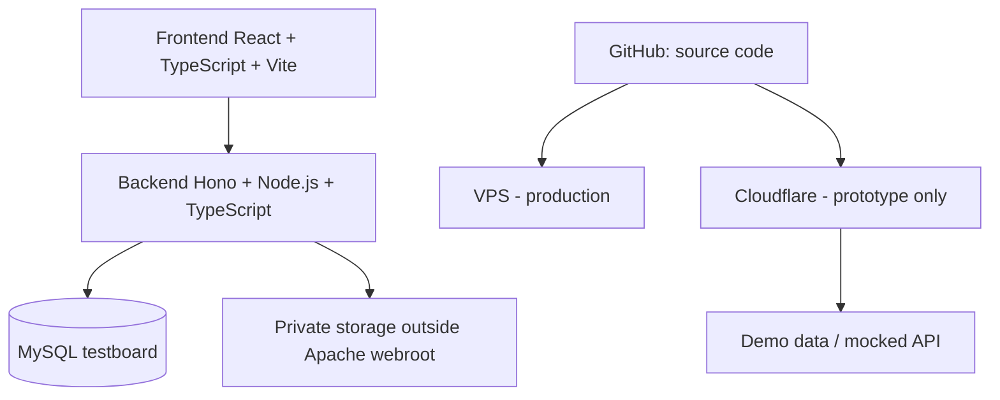

# TestBoard PASKER ID - Blueprint Pengembangan v1.0

**Tanggal penyusunan:** 19 November 2026  
**Status:** Spesifikasi & referensi pengembangan; **BUKAN** source code aplikasi siap pakai  
**Bahasa dokumen:** Indonesia | **UI:** Indonesia + English  
**Database produksi eksisting:** MySQL `testboard` (27 base tables + 1 view sudah dibuat)  
**Konteks deploy:** GitHub repo independen; prototype Cloudflare (data dummy); production VPS Contabo + MySQL VPS.  

## Mulai di sini

1. Baca `docs/01_PRODUCT_VISION_PRD.md` untuk tujuan, scope, dan MVP.
2. Baca `docs/02_FUNCTIONAL_SPECIFICATION.md` untuk aturan proses.
3. Baca `docs/03_UI_UX_DESIGN_SYSTEM.md` dan `docs/04_SITEMAP_AND_SCREEN_SPECS.md` untuk implementasi layar.
4. Baca `docs/05_DATABASE_AND_DATA_DICTIONARY.md` dan `database/schema_baseline_reference.sql`. **Jangan jalankan SQL baseline lagi di VPS yang telah berisi skema.**
5. Baca `docs/06_API_CONTRACT.md`, `docs/07_EVIDENCE_UPLOAD_PROCESSING.md`, `docs/08_IMPORT_LEGACY_AND_AI.md`.
6. Ikuti `docs/11_LOCAL_DEVELOPMENT.md`, lalu `prompts/AI_BUILD_PROMPTS.md` bila menggunakan AI coding agent.
7. Pastikan semua acceptance criteria di `docs/13_UAT_ACCEPTANCE_CRITERIA.md` terpenuhi sebelum dipakai tim.

## Daftar dokumen

| Lokasi | Isi |
|---|---|
| `docs/01_PRODUCT_VISION_PRD.md` | Product requirements, scope, roadmap, KPI |
| `docs/02_FUNCTIONAL_SPECIFICATION.md` | FSD terperinci, aturan status, alur operasional |
| `docs/03_UI_UX_DESIGN_SYSTEM.md` | UI theme, komponen, responsif, aksesibilitas |
| `docs/04_SITEMAP_AND_SCREEN_SPECS.md` | Navigasi, layout, spesifikasi layar/form |
| `docs/05_DATABASE_AND_DATA_DICTIONARY.md` | Struktur database existing, FK, batasan skema |
| `docs/06_API_CONTRACT.md` | API endpoints, payload, error response |
| `docs/07_EVIDENCE_UPLOAD_PROCESSING.md` | Multi-upload, keamanan, kompresi, file lifecycle |
| `docs/08_IMPORT_LEGACY_AND_AI.md` | Import Excel/CSV/JSON, mapping, gambar tertanam |
| `docs/09_AUTH_RBAC_SECURITY.md` | Login, role, keamanan data, audit, backup |
| `docs/10_INTERNATIONALIZATION.md` | EN/ID, kode status, kamus label |
| `docs/11_LOCAL_DEVELOPMENT.md` | Setup lokal Windows/Linux, DB development |
| `docs/12_VPS_CLOUDFLARE_DEPLOYMENT.md` | VPS LAMPP, update.sh, prototype Cloudflare |
| `docs/13_UAT_ACCEPTANCE_CRITERIA.md` | Uji penerimaan TestBoard itu sendiri |
| `docs/14_ROADMAP_BACKLOG.md` | Tahapan coding, dependensi, urutan sprint |
| `docs/15_OPEN_DECISIONS_AND_GAPS.md` | Hal yang belum diputuskan / perlu migrasi skema |
| `docs/16_RESEARCH_REFERENCES.md` | Workbook pengguna & sumber teknis resmi |
| `docs/17_SOURCE_MAPPING.md` | Mapping hasil pemeriksaan 3 workbook pengguna |
| `docs/18_TEXT_WIREFRAMES.md` | Text wireframes untuk dashboard, execution, bug, import |
| `database/schema_baseline_reference.sql` | Snapshot **referensi** SQL yang sudah dijalankan; jangan rerun pada produksi |
| `database/DATABASE_READ_ONLY_CHECKS.sql` | SQL read-only untuk memverifikasi tabel dan view |
| `database/DATA_DICTIONARY_GENERATED.md` | Tabel, kolom, tipe, constraints hasil parsing SQL |
| `examples/ai_testcases_sample.json` | JSON **dummy**, tidak mengandung data pribadi |
| `examples/testcase_import_template.csv` | Header CSV standar |
| `examples/ai_testcases.schema.json` | JSON Schema input AI |
| `examples/Template_Import_Test_Case_UAT.xlsx` | Template XLSX yang sudah dibuat sebelumnya |
| `config/*.env.example` | Template environment lokal tanpa rahasia |
| `config/docker-compose.dev.yml` | Opsional: MySQL lokal untuk pengembangan |
| `ops/update.sh.example` | Contoh alur deployment, **tidak otomatis aman untuk produksi** |
| `AGENTS.md` dan `prompts/AI_BUILD_PROMPTS.md` | Instruksi untuk AI coding agent |

## Arsitektur yang disepakati

- **Produksi**: frontend di Apache, API Node.js di VPS (loopback), MySQL satu VPS; file lampiran disimpan di private storage VPS, **bukan sebagai BLOB** di MySQL.
- **Prototype presentasi**: Cloudflare hanya frontend/opsional mock API memakai data dummy; jangan menaruh kredensial MySQL produksi di Cloudflare atau React.
- **Lokasi repo yang diinginkan pengguna**: `/opt/lampp/htdocs/paskerid/public/testboard/`. Ini dapat digunakan sebagai checkout Git independen, **tetapi sebelum diakses publik Apache harus dibatasi sehingga hanya output frontend `dist` yang dapat disajikan**. Lihat `docs/12_VPS_CLOUDFLARE_DEPLOYMENT.md`.
- **Development lokal**: gunakan database testboard **lokal** terpisah dari database VPS produksi; gunakan `127.0.0.1:3307` jika menjalankan Docker Compose contoh.

## Sumber dan keterbatasan

- Spesifikasi dibangun dari tiga workbook UAT pengguna dan snapshot skema MySQL yang telah diberikan dalam percakapan; rincian ada di `docs/17_SOURCE_MAPPING.md`.
- File Excel asli **tidak disertakan** ke ZIP untuk menghindari distribusi tak sengaja data staf/bukti UAT. Template dan contoh dummy tetap disertakan.
- Sampel data dalam ZIP adalah **dummy**; bukan data yang diambil dari UAT asli.
- SQL baseline **bukan migrasi baru** dan tidak membuat user MySQL; akun `testboard_app` sudah dibuat oleh pengguna di VPS.
- Tidak ada koneksi ke GitHub, Cloudflare, atau database VPS yang dilakukan untuk membuat paket ini.

## Definition of Done sebelum mulai tim memakai aplikasi

- Login + RBAC di sisi backend (bukan sekadar menyembunyikan tombol).
- Impor test case dengan preview, mapping, deduplikasi dan audit.
- Eksekusi, retest, pengaitan bug tanpa menimpa riwayat lama.
- Upload multi-file: scan + optimasi ketika layak + storage privat + metadata DB.
- Dashboard berbasis latest execution per run; ekspor laporan aman.
- Indonesia/English konsisten; mobile responsive; tidak ada kredensial dalam bundle frontend.
- Backup, logging, monitoring, HTTPS dan pengujian keamanan dasar.

**Catatan:** Ini blueprint siap dipakai sebagai acuan coding, bukan software final.
