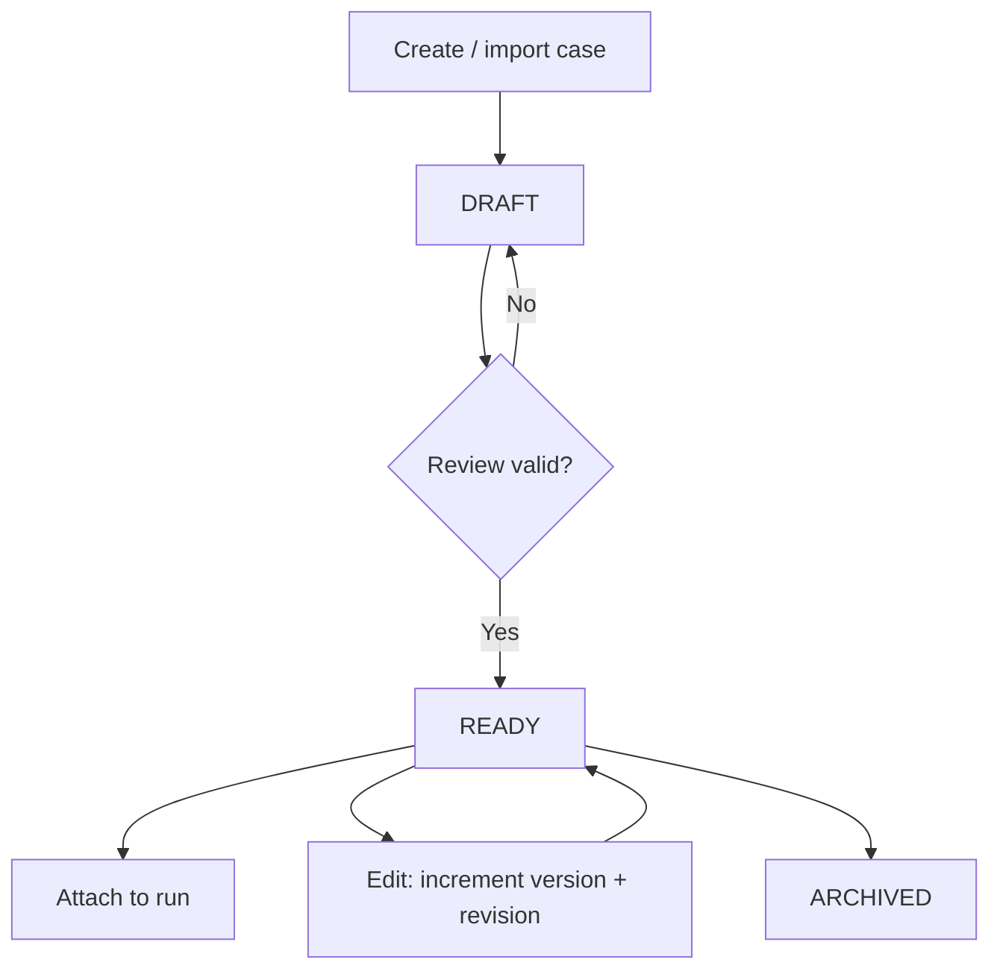
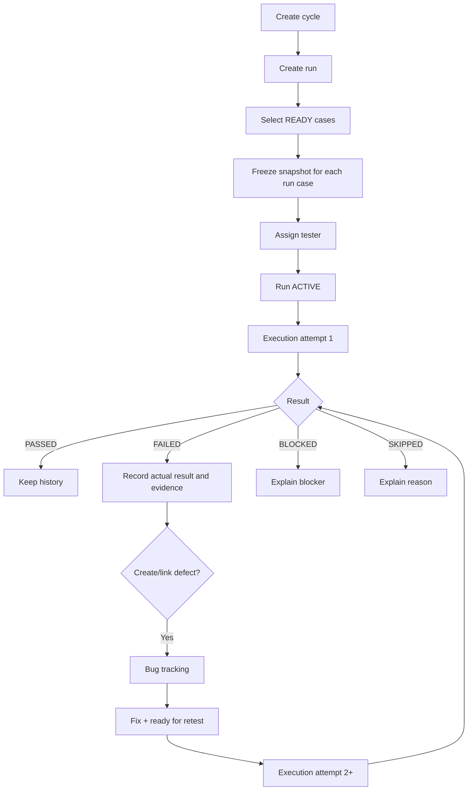
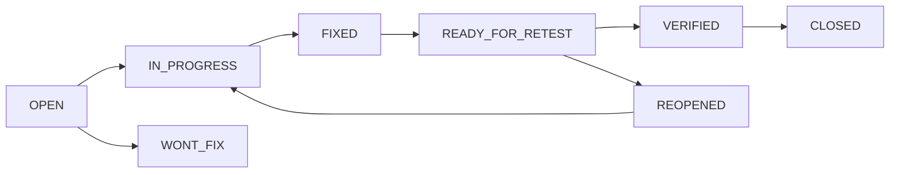

# 02 - Functional Specification Document (FSD)

## 1. Entitas dan relasi proses

1. **Project** memiliki anggota, modul, test suite, test cycle, test run, test case dan defect.
2. **Test Case** adalah definisi reusable (kode, kategori, langkah, expected result), bukan hasil uji.
3. **Test Run** adalah kumpulan test case pada lingkungan dan versi/build tertentu.
4. **Run Case** (`test_run_cases`) adalah satu case terjadwal pada sebuah run, dengan assigned tester dan snapshot.
5. **Execution** (`test_executions`) adalah satu attempt pengujian. Attempt `1` awal; `2+` retest/rerun.
6. **Defect** dapat terkait satu atau banyak executions, atau dibuat mandiri (misalnya bug pasca-UAT).
7. **Evidence** dapat terkait case (dokumen acuan), execution (bukti hasil), atau defect (reproduksi/patch).

## 2. Flow test case

### Ketentuan

- Unique `(project_id, case_code)`, bukan unique global.
- `case_code` dapat dimasukkan manual atau dihasilkan backend dengan atomisitas dan validasi duplikat.
- Field wajib: project, case code, title, expected result; module/suite dianjurkan wajib di UI impor.
- `case_status`: `DRAFT | READY | ARCHIVED`; archival tidak menghapus riwayat.
- Edit setelah pernah dipakai run: tambah `current_version`, simpan snapshot revision; run lama tetap memakai `case_snapshot_json` dan `case_version` lama.
- `test_case_steps` opsional jika pemisahan langkah detail; `test_steps_text` harus tetap menyimpan langkah asli legacy.

## 3. Flow test run & execution

- Run: `PLANNED -> ACTIVE -> COMPLETED` atau `LOCKED` (bila disetujui); edit run yang telah locked dibatasi.
- Attempt dieksekusi menggunakan **database transaction dan lock run case** atau mekanisme atomic untuk menetapkan `attempt_number`, agar dua tester tidak membuat nomor attempt sama.
- Execution status: `NOT_RUN`, `IN_PROGRESS`, `PASSED`, `FAILED`, `BLOCKED`, `SKIPPED`.
- `FAILED`: `actual_result` wajib dan UI menampilkan opsi membuat/link defect; evidence disarankan wajib atau harus memberi alasan bila tidak ada (aturan belum hard constraint di SQL).
- `BLOCKED`: alasan wajib; jangan dihitung passed/failed.
- `SKIPPED`: alasan wajib; jangan mengubah status case master.
- Retest: buat row baru `test_executions`, `execution_kind=RETEST`, `attempt_number` meningkat.
- `test_execution_steps` mendukung hasil tiap langkah. Jika langkah case berubah, history tetap dibaca dari snapshot run agar tidak berubah makna.
- Satu execution bisa punya banyak file; seluruh file harus `READY` dan `scan_status=CLEAN` sebelum diunduh user lain.

## 4. Flow defect

- Status sesuai SQL: `OPEN|IN_PROGRESS|FIXED|READY_FOR_RETEST|VERIFIED|REOPENED|CLOSED|WONT_FIX`.
- `FAILED` test **tidak otomatis mengubah status defect**. Pengguna memilih create/link defect agar tidak menciptakan bug palsu/duplikat.
- Defect wajib mempunyai `project_id`, `bug_code`, `title`, `severity_code`, `priority_code` dan status.
- Boleh dilaporkan setelah UAT, tanpa `defect_execution_links`.
- `bug_code`: auto generate per project, mis. `BUG-KAR-0001`, transaksional.
- Severity: `CRITICAL|HIGH|MEDIUM|LOW|INFO`; priority: `URGENT|HIGH|MEDIUM|LOW`.
- Developer dapat mark FIXED, tester/QA melakukan verifikasi; jika gagal retest: REOPENED dengan alasan.
- Saat perubahan status, tulis `defect_status_history` dan `audit_logs` dalam transaksi yang sama.
- Diskusi bug disimpan di `defect_comments`, lampiran di `defect_files`.

## 5. Import test cases

1. Pengguna memilih project, target module/suite, mode impor dan file.
2. Backend upload sementara ke area privat; validasi ekstensi, signature, ukuran dan anti-malware.
3. Parser XLSX/CSV/JSON membaca sheet/header (termasuk sheet berbeda format).
4. Form mapping kolom dengan sample preview & penjelasan field wajib.
5. Normalisasi status, tanggal, prioritas, tipe uji; tangani formula dan empty rows; cari ID duplikat.
6. Preview menampilkan angka valid/error/duplicate; pengguna memilih skip/update/new revision.
7. Konfirmasi commit secara bertahap/transaction batch; masukkan `import_jobs` dan `import_job_rows` dengan error per baris.
8. Jika mode legacy hasil UAT diaktifkan, buat run & execution secara **eksplisit**; tidak otomatis menganggap `Status Retest=Closed` sebagai passed.
9. File Excel berisi embedded image: relasi gambar dengan cell anchor melalui `import_job_row_files`, `file_objects`, kemudian link ke execution/bug sesuai hasil review.

## 6. File evidence

- Multi-file upload dan drag/drop di case, execution, defect; ada kategori screenshot/video/document/log.
- File source tidak disimpan sebagai binary di MySQL; `file_objects` berisi metadata private key dan processing status.
- Semua file **wajib melewati pemeriksaan/optimasi pipeline**, tetapi file yang sudah terkompresi atau format lossless tertentu mungkin tidak lebih kecil; simpan penjelasan `compression_note` (jangan memaksakan kualitas turun).
- Tidak ada direct public URL; download/preview melalui backend authorization.

## 7. Role & akses

- `ADMIN`: project settings/member, seluruh modul dan laporan pada project.
- `QA_LEAD`: kelola case, suite, run, assign, import; review bug; laporan.
- `TESTER`: menjalankan assigned cases, upload evidence, lapor bug, komentar.
- `DEVELOPER`: baca case/run, kelola defect assigned, update fix/status, komentar; tidak mengubah expected result.
- `VIEWER`: baca data project yang diizinkan (attachment mengikuti izin baca), ekspor sesuai kebijakan.
- Role ada pada `project_members`. **Global Super Admin belum direpresentasikan pada schema**; lihat gap.

## 8. Audit & report

- Audit create/update/delete/STATUS_CHANGE/IMPORT/DOWNLOAD dengan actor, project, entity, request ID dan timestamp; sensitif redaction.
- Dashboard tidak boleh menghitung 3 attempt sebagai 3 test cases.
- Ekspor XLSX/CSV untuk laporan; hindari formula injection di kolom buatan user.
- Semua query scoped pada `project_id` dan role user; route parameter ID bukan bukti hak akses.

## 9. Error handling

- Validasi field sebelum submit, error per field jelas dalam ID/EN.
- API error berbentuk `code`, `message`, `details`, `request_id`.
- Jangan menampilkan stack trace, SQL atau storage key ke browser.
- File processing asynchronous menampilkan status `PROCESSING`; gagal -> `FAILED/REJECTED` dengan alasan yang aman.
- Semua operasi berulang sensitif gunakan idempotency key untuk mencegah double create.

## 10. Contoh aturan yang tidak boleh dilanggar

- Edit test case asli tidak boleh mengubah hasil UAT historis.
- Hasil Passed pada retest tidak menghapus FAILED pada attempt sebelumnya.
- Defect CLOSED tidak otomatis mengubah execution FAILED lama menjadi PASSED.
- Semua data hanya dapat dilihat dari project tempat user menjadi anggota dan diberi izin.
- `Status Retest` pada Excel lama berbeda dengan status execution dan harus diproses sebagai informasi legacy, bukan dinormalisasi diam-diam.
