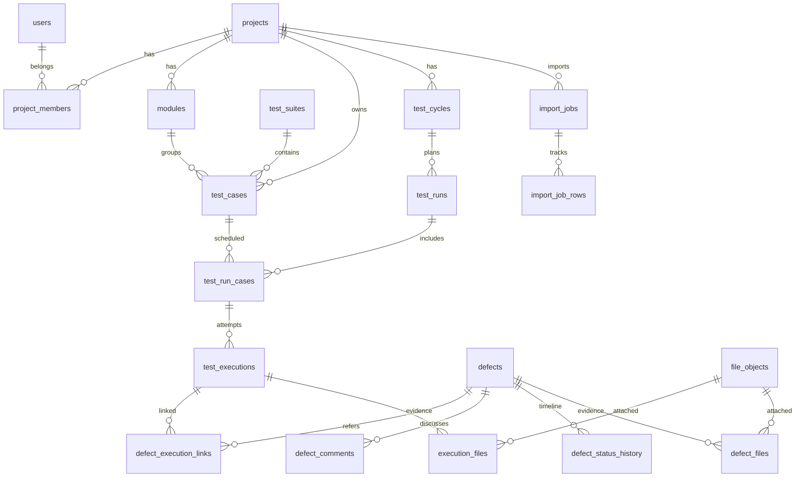

# 05 - Database MySQL: Existing Schema & Mapping

**Fakta yang sudah dikonfirmasi pengguna:** Database produksi bernama `testboard`; 27 `BASE TABLE` dan view `v_run_case_latest_status` sudah berhasil dibuat di satu server VPS MySQL. User MySQL `testboard_app` telah dibuat dan diuji dari MobaXterm. IP/port dan password tidak dicantumkan dalam blueprint.

## Prinsip utama

- **Jangan menjalankan ulang SQL baseline di produksi** hanya untuk development lokal.
- Snapshot source of truth pada paket ini: `database/schema_baseline_reference.sql` (salinan asli file schema yang tersedia saat penyusunan).
- Pengembangan lokal memakai DB MySQL terpisah (boleh juga bernama `testboard` dalam container lokal), bukan koneksi langsung ke VPS.
- Backend (bukan frontend) menggunakan user MySQL `testboard_app` dengan privilege CRUD terbatas; migration via DBA/akun migrasi.
- Tidak menyimpan binary lampiran dalam MySQL. `file_objects` menyimpan metadata private storage key.
- Semua foreign key dipatuhi; penghapusan dilakukan sesuai aturan restrict/cascade yang sudah ada.

## Kelompok tabel (sesuai skema existing)

| Domain | Tabel | Fungsi |
|---|---|---|
| Auth/Projects | `users`, `projects`, `project_members`, `modules` | User, scope project dan module |
| Library | `test_suites`, `test_cases`, `test_case_steps`, `test_case_revisions`, `test_case_translations` | Test case, revisi dan konten bilingual |
| Planning & execution | `test_cycles`, `test_runs`, `test_run_cases`, `test_executions`, `test_execution_steps` | Siklus, run, assignment, attempt/retest |
| Defects | `defects`, `defect_execution_links`, `defect_comments`, `defect_status_history` | Bug standalone dan terkait execution |
| Evidence | `file_objects`, `execution_files`, `defect_files`, `test_case_files` | Metadata + multi-attachment |
| Import | `import_jobs`, `import_job_rows`, `import_job_row_files` | Import historis & file yang tertanam di baris |
| Settings & audit | `project_settings`, `audit_logs` | Konfigurasi dan jejak aktivitas |
| View | `v_run_case_latest_status` | Status attempt terbaru per run-case |

## ERD logical (subset)

## Status dan aturan database

### Test case

`case_status`: `DRAFT | READY | ARCHIVED`; `source_kind`: `MANUAL | LEGACY_IMPORT | AI_IMPORT`; `priority_code`: `MUST_HAVE | SHOULD_HAVE | COULD_HAVE | WONT_HAVE`; `test_type_code`: `POSITIVE|NEGATIVE|RBAC|SLA|UI_UX|INTEGRATION|OTHER`.

### Execution

`result_status`: `NOT_RUN|IN_PROGRESS|PASSED|FAILED|BLOCKED|SKIPPED`; `execution_kind`: `INITIAL|RETEST|RERUN`.

- Unik `(run_case_id, attempt_number)`; append-only logic untuk history. Jangan overwrite attempt.
- `case_snapshot_json` di `test_run_cases` dipakai untuk freeze definisi test case ketika run dimulai.

### Defects

`status_code`: `OPEN|IN_PROGRESS|FIXED|READY_FOR_RETEST|VERIFIED|REOPENED|CLOSED|WONT_FIX`; `severity_code`: `CRITICAL|HIGH|MEDIUM|LOW|INFO`; `priority_code`: `URGENT|HIGH|MEDIUM|LOW`.

### File

`processing_status`: `PROCESSING|READY|FAILED|REJECTED`; `scan_status`: `PENDING|CLEAN|INFECTED|ERROR`. `READY` dan `CLEAN` harus dua-duanya terpenuhi untuk penggunaan normal.

## Catatan teknis penting untuk programmer

- Kolom PK `BIGINT UNSIGNED`: pada JSON lebih aman dikirim **sebagai string** untuk mencegah precision loss di JavaScript.
- Timestamp `DATETIME(3)` tidak menyimpan timezone; sepakati semua timestamp backend disimpan sebagai UTC, lalu tampilkan Asia/Jakarta di UI. Konversi saat import tanggal lama.
- `users.password_hash` harus Argon2id/bcrypt yang disetujui; tidak ada password plaintext.
- `users.preferred_locale` (`id|en`) untuk UI preference; `test_case_translations` untuk isi case tertentu. Tidak semua data bebas teks auto-translate.
- API harus validasi bahwa `module_id`, `suite_id`, `run_id`, `case_id`, `file_object_id` yang ditautkan benar-benar berasal dari project sama: FK biasa di SQL tidak menjamin **cross-project consistency** tersebut.
- `test_execution_steps` merujuk `test_case_steps` saat ini. Untuk historis, gunakan snapshot pada run/execution (atau migration tambahan jika dibutuhkan) agar edit langkah tidak merusak interpretasi lama.
- `audit_logs` tidak boleh berisi password, token atau raw file content.

## Keterbatasan skema existing - jangan diam-diam dianggap sudah ada

1. Belum ada tabel `sessions` / password-reset / user invitations. Perlu migration, atau desain sesi signed-cookie dengan storage sesuai threat model yang disetujui.
2. Belum ada global `SUPER_ADMIN` role; yang tersedia ialah `project_members.role_code`, per project.
3. Belum ada entity `notifications`, `watchers`, `tags`, `releases`, `saved_filters`, `assignment_history`, `comment_attachments` khusus.
4. Upload job queue tidak memiliki tabel tersendiri; dapat memakai worker/job queue filesystem/database tambahan dengan desain idempotent.
5. Tidak ada field `defects.due_date`, `fix_commit`, `resolution_reason`, maupun join ke external ticket; perlu schema migration jika fitur diminta.
6. Belum ada DB-level enum/constraint untuk semua status string; backend harus validasi whitelist status dan transition.
7. Belum ada status `PENDING` untuk defect walau status retest tracker memiliki label Pending; **jangan mengimpor langsung tanpa mapping keputusan**.

**Jangan edit tabel produksi untuk memenuhi gap tanpa membuat dan menguji migration terpisah yang disetujui**. Lihat `docs/15_OPEN_DECISIONS_AND_GAPS.md`.

## Query verifikasi

Lihat `database/DATABASE_READ_ONLY_CHECKS.sql`. Gunakan `SHOW TABLES` dan `INFORMATION_SCHEMA`; jangan membuat user atau membuat ulang schema dari aplikasi frontend.

## Data dictionary rinci

`database/DATA_DICTIONARY_GENERATED.md` dibuat otomatis dari definisi kolom baseline, sehingga nama/tipe kolom di dokumen tidak tertukar dengan asumsi baru.
