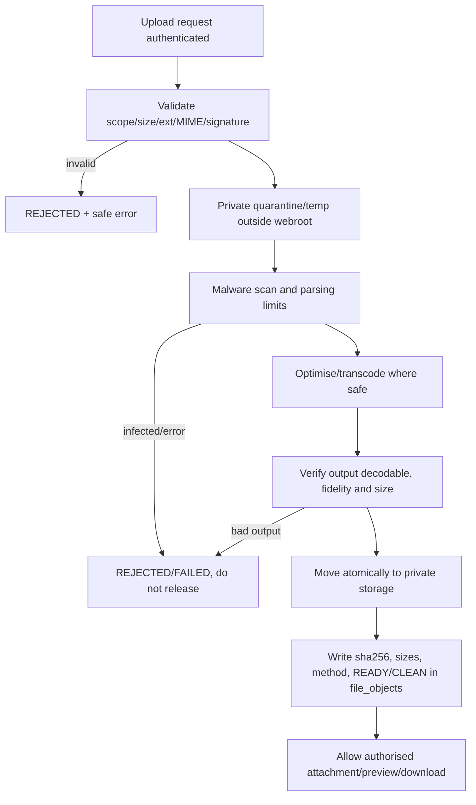

# 07 - Evidence Upload, File Processing, dan Compression

## Requirement utama

Pengguna membutuhkan **lebih dari satu attachment** per test case / execution / bug: screenshot, rekaman layar, dokumen, technical logs, dan file pendukung lain. Setiap file menjalani proses pemeriksaan/optimasi sebelum tersedia secara normal; simpan file di **private VPS storage** dan hanya metadata di MySQL.

## UI uploader

- Sediakan 4 kategori sebagai navigasi praktis: `SCREENSHOT`, `VIDEO`, `DOCUMENT`, `LOG` (+ `OTHER` bila disetujui).
- Area upload menerima multiple files; select, drag/drop, paste screenshot dari clipboard.
- Preview thumbnails, nama, ukuran awal, progres, status scan/process, retry, cancel, caption, urutan, hubungkan ke step.
- Untuk Failed execution, evidence dapat ditambahkan sebelum/selama membuat bug; bukti dari execution dapat direferensikan dalam bug **tanpa menggandakan binary**.
- Tampilan gallery foto dan player video melalui authorized stream, bukan URL publik.

## MIME / batas ukuran (DEFAULT USULAN, configurable)

| Jenis | Format usulan | Limit per file | Strategi |
|---|---|---:|---|
| Screenshot | PNG, JPG/JPEG, WebP | 15 MiB | Validasi decode, EXIF strip, lossless optimize untuk teks UI; JPEG/WebP quality dipilih dengan menjaga keterbacaan |
| Screen recording | MP4, WebM | 250 MiB | Proses async ffmpeg bila tersedia, H264/AAC/WebM sesuai policy; jika codec asli efisien, simpan hasil tervalidasi dengan note |
| Document | PDF, DOCX, XLSX | 25 MiB | Scan/validate; kompresi/archive hanya jika aman dan tidak mengubah format/konten penting |
| Technical log | TXT, CSV, JSON, HAR | 20 MiB | Validasi, redaksi data sensitif bila diminta, gzip untuk storage jika efektif; download dengan nama/format terkontrol |

- Multi-file per form: contoh awal 10 file, total request max 300 MiB; dibuat sebagai `project_settings`/server limits bila fitur sudah siap.
- **Ini bukan batas resmi yang diturunkan dari file Excel lama.** Angka adalah usulan dan bisa berubah setelah uji performa.
- ZIP, EXE, PHP, SVG aktif dan macro-bearing files: blok default sampai dibutuhkan dan ada threat review.

## Pipeline wajib



## Interpretasi 'always compress'

- **Wajib mencoba memproses semua file melalui pipeline**, tetapi *tidak semua file bisa menjadi lebih kecil* tanpa merusak kualitas atau membuatnya tidak dapat dibuka.
- Optimasi gambar yang menampilkan UI kecil sebaiknya **lossless** atau kualitas tinggi; jangan mengurangi resolusi screenshot sampai teks tak terbaca.
- JPEG/MP4/PDF/DOCX/XLSX sudah bisa terkompresi secara internal; bila hasil optimasi lebih besar atau invalid, simpan input asli yang sudah lulus scan (atau rewrite yang valid) dan catat `compression_note = 'NO_SIZE_GAIN'`, **bukan memaksakan zip**, karena user masih harus bisa preview.
- EXIF/metadata GPS harus dihapus dari screenshot/foto jika tidak dibutuhkan, dan original filename tidak dijadikan path file di storage.
- `compression_method` dan ukuran awal/akhir wajib tercatat di file_objects.

## Penyimpanan VPS

- Rekomendasi: `/var/lib/testboard/storage/objects/` dan `/var/lib/testboard/storage/tmp/` atau lokasi privat lain di luar Apache webroot, dimiliki oleh service account terbatas.
- `storage_backend='PRIVATE_LOCAL'`; `bucket_name='testboard'` sebagai namespace logis; `object_key='project-id/year/month/uuid.ext'` (tidak memuat data pribadi).
- `file_objects` menyimpan `stored_mime`, `size`, `hash`, `width/height`, `thumbnail_object_key`, `processing_status`, `scan_status`.
- `execution_files`, `test_case_files`, `defect_files` untuk relasi banyak-ke-banyak.
- Saat penghapusan relasi, file object fisik dihapus hanya bila tidak ada reference dan retention policy mengizinkan; lakukan asynchronous garbage collection dengan audit.

## Download, preview & keamanan

- Backend cek session + role + project + izin entitas pada setiap request.
- Jangan expose URL file lokal atau object key; gunakan streamed handler.
- Gunakan `Content-Disposition: attachment` untuk tipe berisiko, `nosniff`, CSP sesuai policy.
- Video support HTTP Range jika player memerlukan streaming; jangan load 250MB sebagai satu buffer memory.
- Verify MIME melalui magic bytes/decode; default deny; limit pixel/decompression bomb, file count, zip bomb.
- Proses scan bisa gagal; dalam kondisi tersebut tidak boleh diset `CLEAN`.
- Pertimbangkan AV ClamAV; processing image Sharp, video FFmpeg **di backend VPS**, bukan frontend.
- Jangan menjalankan proses imagemagick/ffmpeg dengan privileges root tanpa isolasi dan resource limits.

## Model data contoh

```json
{
  "file_object_id":"88",
  "project_id":"2",
  "storage_backend":"PRIVATE_LOCAL",
  "bucket_name":"testboard",
  "object_key":"2/2026/11/4af0b231.webp",
  "original_filename":"bug-login.png",
  "original_mime":"image/png",
  "stored_mime":"image/webp",
  "evidence_type":"SCREENSHOT",
  "original_size_bytes":2578012,
  "stored_size_bytes":802103,
  "compression_method":"WEBP_LOSSLESS",
  "processing_status":"READY",
  "scan_status":"CLEAN"
}
```

Contoh di atas data dummy, bukan record database nyata.

## Performance & QA

- Latency UI upload: tampil progres, tidak memblokir pengguna selama video transcode; worker/job queue dipisahkan dari request HTTP.
- Uji file 0 byte, extension spoofing, invalid headers, zip bomb, overly large image, virus test file di lingkungan aman, storage full, concurrent upload, interrupted network.
- Metrik: p50/p95 processing latency, compression ratio by MIME, scan fail/error rate, storage usage, orphaned file count.
- Batas storage/retensi baru ditetapkan oleh pengelola; jangan hapus otomatis tanpa kebijakan.

## Sumber teknis

OWASP File Upload: https://cheatsheetseries.owasp.org/cheatsheets/File_Upload_Cheat_Sheet.html
